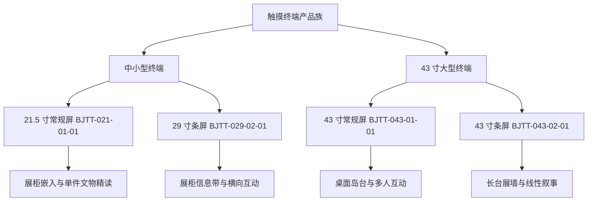
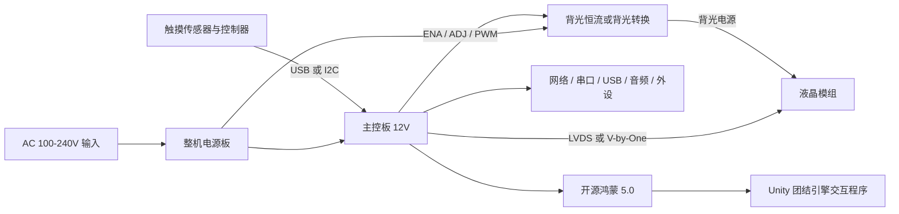
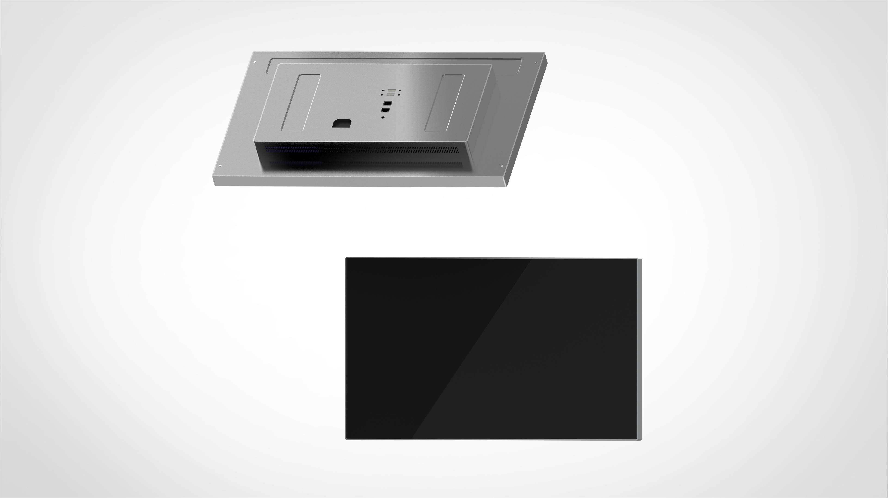
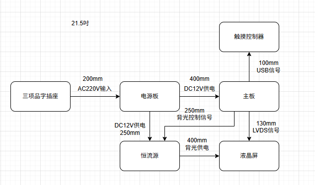
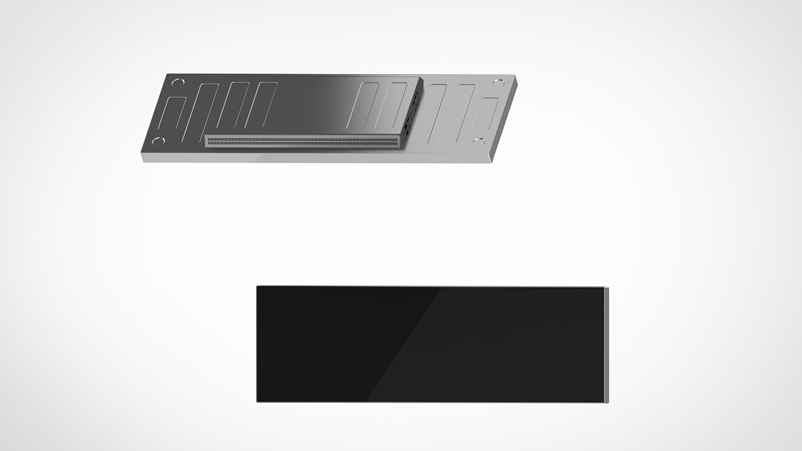
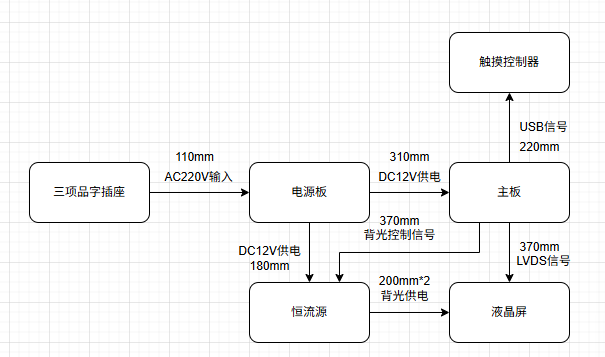
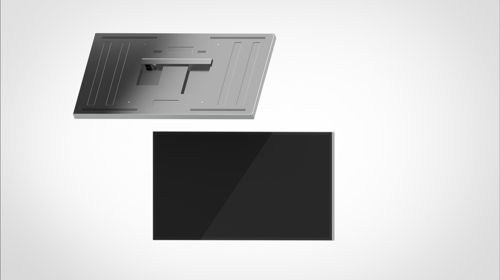
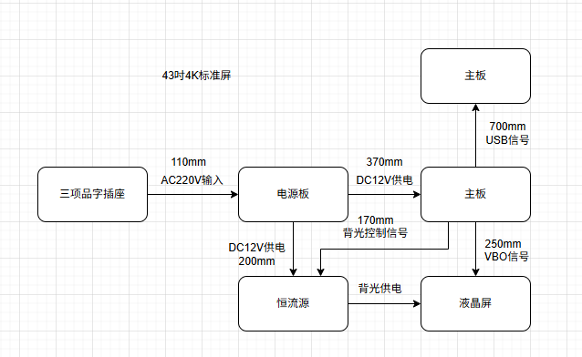
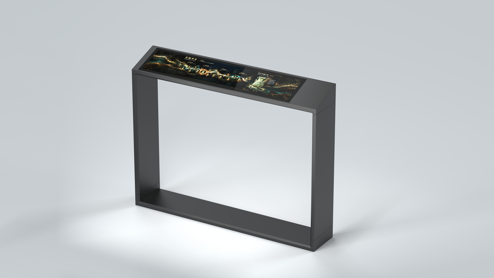
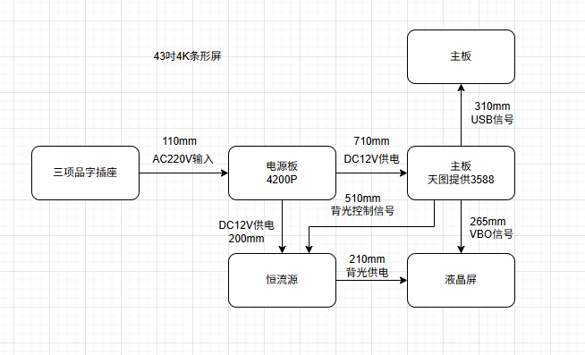

# 触摸终端产品族四款产品交接报告

**文档用途**：产品研发交接与产品白皮书编制底稿  
**覆盖产品**：21.5 寸常规终端、29 寸条屏终端、43 寸常规屏终端、43 寸条屏终端  
**资料基准日**：2026-10-15  
**文档版本**：V1.1（结构化项目框架与信息索引补充版）  
**文档状态**：内部工程交接基线；未验证内容不得直接转为对外承诺  
**资料来源**：硬件规格书原始目录、研发工作台数据库、服务器文件库、工程模型与现有拓扑图

**关联总报告**：`触摸终端产品族全项目调研总报告_20261015.md`，用于把早期产品定义、扩展交互、工程研发和项目治理合并阅读。

> 本报告不是研发工作台的软件开发报告。它以产品为中心，自上而下汇总四款终端的定位、机械尺寸、显示与触摸、主控平台、电气方案、软件能力、装配方式、当前状态、风险、资料索引与交接清单，供接手人继续工程收敛并着手编写产品白皮书。

---

## 快速导航

| 使用目的 | 入口 |
|---|---|
| 先判断项目处于什么阶段、下一步做什么 | [0 项目控制框架与总索引](#0-项目控制框架与总索引)、[1 报告结论与交接重点](#1-报告结论与交接重点) |
| 比较四款产品的定位、尺寸、平台和阶段 | [2 产品族总框架](#2-产品族总框架) |
| 查看单款产品的完整技术信息 | [3 21.5 寸](#3-215-寸常规终端-bjtt-021-01-01)、[4 29 寸条屏](#4-29-寸条屏终端-bjtt-029-02-01)、[5 43 寸常规屏](#5-43-寸常规屏终端-bjtt-043-01-01)、[6 43 寸条屏](#6-43-寸条屏终端-bjtt-043-02-01) |
| 统一尺寸、电气、软件和测试口径 | [7 跨机型设计、验证与白皮书口径](#7-跨机型设计验证与白皮书口径) |
| 查找规格书、图纸、模型、拓扑和数据库 | [8 文件位置索引](#8-文件位置索引) |
| 执行配置冻结、结构、电气、软件、采购和测试交接 | [9 完整交接清单](#9-完整交接清单) |
| 查看白皮书仍缺什么 | [10 白皮书待补信息总表](#10-白皮书待补信息总表) |
| 查看决策、风险、行动和交付物编号 | [12 项目主索引](#12-项目主索引) |

---

## 0 项目控制框架与总索引

### 0.1 项目定义

| 项目字段 | 当前定义 |
|---|---|
| 项目名称 | 触摸终端产品族研发与工程收敛 |
| 产品范围 | 21.5 寸常规、29 寸条屏、43 寸常规、43 寸条屏四款信息交互终端 |
| 当前阶段 | 由资料收敛和工程方案阶段向配置冻结、样机闭环与 EVT 验证阶段过渡 |
| 核心目标 | 建立可复用工程内核，形成四款受控配置、完整 BOM、接口控制、样机验证和白皮书证据链 |
| 当前主线 | 21.5 寸完成电气与功能闭环；29 寸完成总成包、电子仓和结构冻结；两款 43 寸继承已验证规则 |
| 对外发布门槛 | 只有已冻结配置和有验证证据的参数可以进入产品白皮书或合同承诺 |
| 非本报告范围 | Rhino AI 建模方法、复杂曲面研究、建模脚本和工具插件开发记录 |

### 0.2 项目信息对象关系

项目资料统一按下列关系组织，后续数据库、文件命名、周报和白皮书均应沿用同一逻辑：

```text
产品 Terminal
  └─ 总成 Assembly
      └─ 模块 / 物料 Component & BOM Item
          ├─ 接口与关键参数 Interface / ICD
          ├─ 文件证据 Evidence
          ├─ 任务 Action
          ├─ 测试记录 Test
          ├─ 风险 Risk
          └─ 决策与变更 Decision / Change
```

管理原则：任务完成不等于参数已验证；文件存在不等于配置已冻结；平台支持不等于整机已经开放。任何关键参数必须同时具备“对象归属、版本、状态、来源和验证结果”。

### 0.3 统一编号规则

建议从本报告之后新增的配置、任务和证据统一使用稳定编号：

```text
BJTT-[机型]-[资料域]-[三位序号]
```

| 维度 | 可用代码 | 示例 |
|---|---|---|
| 机型 | 021、029、043S、043B、FAM（产品族共用） | `BJTT-029-ELC-001` |
| 资料域 | CFG 配置、ICD 接口、DSP 显示、TP 触摸、CTL 主控、ELC 电气、MEC 结构、SW 软件、BOM 物料、TST 测试、EVD 证据、DEC 决策、RSK 风险、CHG 变更 | `BJTT-FAM-TST-001` |
| 版本 | 文档或数据对象单独使用 V0.x/V1.x；正式冻结后升为 V1.0 | `BJTT-021-CFG-001_V0.3` |

稳定 ID 不随文件名、负责人或目录移动而改变。文件更名或替换时，只更新版本和证据路径。

### 0.4 阶段门与当前定位

| 阶段门 | 通过条件 | 21.5 寸 | 29 寸条屏 | 43 寸常规 | 43 寸条屏 |
|---|---|---|---|---|---|
| M0 资料收敛 | 规格、图纸、候选物料和冲突清单齐全 | 已通过 | 已通过 | 进行中 | 进行中 |
| M1 总成包 | 屏、触摸、主板、电源、结构、软件形成同版组合 | 进行中 | 进行中，资料最集中 | 未通过 | 未通过 |
| M2 点亮闭环 | 原生分辨率、触摸、接口、音频和掉电恢复有记录 | 待执行，优先 | 待供电方案冻结后执行 | 待执行 | 待执行 |
| M3 结构样机 | 装配、线束、散热、检修和安装方式验证 | 待执行 | 电子仓与结构冻结中 | 待执行 | 待执行 |
| M4 EVT | 电气、温升、ESD、可靠性和安装验证关闭 | 未进入 | 未进入 | 未进入 | 未进入 |
| M5 产品族发布 | 受控 BOM、白皮书、维护包和量产/交付边界明确 | 未进入 | 未进入 | 未进入 | 未进入 |

阶段说明：29 寸仍是“总成包管理模板机型”；21.5 寸由于电源、拓扑和接线资料较完整，适合作为首个电气与功能闭环样机。两条主线并行但验收目标不同。

### 0.5 信息状态与证据状态

项目同时维护两组状态，禁止混用：

| 维度 | 状态 | 含义 |
|---|---|---|
| 工作状态 | planned / waiting_decision / implemented_unverified / verified / stale / blocked | 表示工作推进到哪一步 |
| 证据状态 | confirmed / assumed / missing / conflict | 表示结论是否有可靠来源以及来源是否一致 |

例如“电气拓扑已画完”应记录为 `implemented_unverified`；如果主板、电源和屏规格之间仍有冲突，则证据状态同时为 `conflict`，不能因为图已完成而标记为 `verified`。

### 0.6 单一事实来源优先级

| 优先级 | 来源 | 使用规则 |
|---:|---|---|
| 1 | 与实物版本一致的正式图纸、承认书、受控规格书、正式检测报告 | 可作为冻结和对外参数依据 |
| 2 | 样机实测、评审签字记录、供应商书面确认 | 可关闭对应验证项，必须记录样机编号和条件 |
| 3 | 已批准的配置基线、BOM、接口控制表、二维结构图和电气原理图 | 工程执行依据；上游变更后需重新评估 |
| 4 | 当前数据库、工程模型、拓扑图和内部工作报告 | 用于推进与发现冲突，不能自动覆盖 1—3 级来源 |
| 5 | 效果图、历史报价、概念方案和口头信息 | 仅作参考，必须标记 assumed 或 stale |

不同来源冲突时不直接选择“最新文件覆盖旧文件”，应创建 `DEC` 或 `CHG` 记录，说明采用值、影响范围和批准人。

### 0.7 总信息索引

| 索引对象 | 主编号 | 当前入口 | 当前状态 | 下一项受控输出 |
|---|---|---|---|---|
| 产品族总基线 | BJTT-FAM-CFG-001 | 本报告第 2、7、12 节 | V1.1 内部基线 | 产品族配置基线 V1.0 |
| 21.5 寸配置 | BJTT-021-CFG-001 | 第 3 节 | implemented_unverified | 整机配置基线、点亮与温升记录 |
| 29 寸配置 | BJTT-029-CFG-001 | 第 4 节 | waiting_decision | 供电决策、电子仓冻结、整机配置基线 |
| 43 寸常规配置 | BJTT-043S-CFG-001 | 第 5 节 | planned / conflict | 屏型号与工程模型对齐、整机配置基线 |
| 43 寸条屏配置 | BJTT-043B-CFG-001 | 第 6 节 | implemented_unverified / conflict | 主板与电源拓扑修订、整机配置基线 |
| 共用接口控制 | BJTT-FAM-ICD-001 | 第 7.1、7.2 节 | planned | 四款 Interface Control 主表 |
| 共用软件基线 | BJTT-FAM-SW-001 | 第 2.6、7.3 节 | implemented_unverified | 镜像、应用、配置、日志和恢复包索引 |
| 共用测试矩阵 | BJTT-FAM-TST-001 | 第 7.5 节 | planned | EVT 测试计划、样机编号与证据目录 |
| 文件证据库 | BJTT-FAM-EVD-001 | 第 8 节 | 已建立初始索引 | 去重、校验、受控版本和失效标记 |
| 产品白皮书 | BJTT-FAM-CFG-002 | 第 7.6、9.8、10 节 | blocked | 待配置冻结和测试证据完成后编制 |

---

## 1 报告结论与交接重点

### 1.1 一页结论

四款终端已经形成清晰的产品族框架：以 **21.5 寸和 29 寸**覆盖中小型展柜、信息带与单人互动，以 **43 寸常规屏和 43 寸条屏**覆盖桌面岛台、多人共览、长台和展墙。硬件上形成两级主控平台，21.5 寸与 29 寸以 RK3568 为主，43 寸产品以 RK3588 为主；显示形态则分为 16:9 常规屏和超宽条屏两类。

当前最重要的交接判断如下：

1. **21.5 寸与 29 寸已进入“总成包”阶段**，已有整机效果图、工程模型和电气拓扑，具备继续做样机收敛的基础。
2. **43 寸常规屏与 43 寸条屏仍处于“资料收敛”阶段**，显示与主板规格较完整，但整机电源、触摸、线束、结构与验证方案尚未全部锁定。
3. **整机尺寸必须按四层口径管理**：整机正面外轮廓、盖板 OD、液晶模组 OD、面板有效显示区 AA。现有资料中部分“显示尺寸”实际是视窗尺寸，不能与面板 AA 混用。
4. **29 寸供电方案尚未冻结**：BOM 中存在 12V/5A 适配器候选，现有拓扑又采用 AC 输入电源板加恒流源，两者是不同架构，必须在白皮书前完成选型确认。
5. **43 寸条屏拓扑版本与主板资料未完全对齐**：数据库指向 ZC-3588A，拓扑仅写“天图提供 3588”；拓扑中还将触摸控制器误标为“主板”。这张图应在交付客户或进入白皮书前修订。
6. **整机软件技术路线已经明确**：四款终端当前统一采用开源鸿蒙（OpenHarmony）5.0，终端交互程序使用 Unity 中国版团结引擎开发，并可面向项目提供定制交互程序服务。仍需补齐系统镜像、应用构建包、开机流程、内容更新、日志、远程维护、异常恢复和触摸标定的正式版本记录。
7. **四款产品均不应直接宣称达到 IP54、ESD、温升、可靠性或量产状态**。现有记录多为目标或待验证项，白皮书只能把已验证结果写成性能承诺。

### 1.2 资料可信度标记

报告使用以下标记帮助接手人判断信息成熟度：

| 标记 | 含义 | 使用规则 |
|---|---|---|
| 已确认 | 来自供应商规格书、正式图纸或数据库已确认字段 | 可进入工程基线，仍需核对实物版本 |
| 工程值 | 来自当前整机模型、研发工作台或拓扑图 | 可用于现阶段设计，不等同于量产冻结 |
| 候选 | 已有规格书或 BOM 条目，但尚未完成样机验证 | 不应写成最终配置 |
| 待确认 | 资料缺失、版本冲突或尚无测试证据 | 必须进入交接清单 |

### 1.3 接手后的优先顺序

1. 冻结每款产品的屏、主板、电源、触摸控制器和线束版本。
2. 建立四层尺寸基线，并让结构图、全贴合图、3DM 模型和前端数据一致。
3. 补齐每款整机 BOM、供应商、含税价、交期、替代料和物料版本。
4. 固化系统镜像与应用版本，建立升级、恢复、日志和内容发布流程。
5. 按统一测试矩阵完成点亮、触摸、接口、温升、ESD、可靠性和安装验证。
6. 测试通过后再形成面向市场的产品白皮书参数表。

---

## 2 产品族总框架

### 2.1 产品族分层



### 2.2 型号命名规则

现有型号遵循 `BJTT-尺寸-屏型-版本`：

| 字段 | 示例 | 建议定义 |
|---|---|---|
| 产品族 | BJTT | 触摸终端产品族固定前缀 |
| 尺寸 | 021、029、043 | 屏幕标称英寸，三位数字 |
| 屏型 | 01、02 | 01 为常规屏，02 为条屏 |
| 版本 | 01 | 整机产品版本，结构、电气或关键物料变更时递增 |

建议后续补充物料版本、软件版本和地区/客户配置，不要继续塞入产品主型号。可采用：

```text
产品型号：BJTT-043-02-01
硬件配置：HW-A
系统镜像：OS-OH5-R01
交互程序：APP-TUANJIE-1.0.0
BOM 版本：BOM-V0.3
```

### 2.3 四款产品总览

| 产品 | 产品型号 | 分辨率 | 当前整机正面外轮廓 | 面板有效显示区 AA | 主控平台 | 当前阶段 | 核心场景 |
|---|---|---:|---:|---:|---|---|---|
| 21.5 寸常规终端 | BJTT-021-01-01 | 1920 x 1080 | 507.6 x 304.2 mm | 476.064 x 267.786 mm | AIoT-3568A / RK3568 | 总成包 | 展柜嵌入、单件文物精读、图文详情 |
| 29 寸条屏终端 | BJTT-029-02-01 | 1920 x 540 | 745 x 238 mm | 705.6 x 198.45 mm | AIoT-3568A / RK3568，候选 | 总成包 | 展柜信息带、横向互动、三维环物、小游戏 |
| 43 寸常规屏终端 | BJTT-043-01-01 | 3840 x 2160 | 977.7 x 566.1 mm | 941.184 x 529.416 mm | AIoT-3588A / RK3588 | 资料收敛 | 桌面岛台、多人共览、互动游戏、视频展示 |
| 43 寸条屏终端 | BJTT-043-02-01 | 3840 x 720 | 1124.30 x 240.50 mm | 1073.779 x 201.3336 mm | ZC-3588A / RK3588 | 资料收敛 | 长台、展墙、时间轴、多人分区卡片 |

### 2.4 四款产品的共用总成架构

所有产品都应按五个总成管理，而不是把所有问题混在一张整机图中：

| 总成 | 范围 | 主要交付物 |
|---|---|---|
| 屏幕模组与全贴合触摸板 | LCD、背光、盖板、传感器、触摸控制器、贴合工艺 | 屏规格、盖板图、触摸规格、全贴合图、显示与触摸测试记录 |
| 主控与系统总成 | 主板、内存、存储、网络、接口、系统镜像 | 主板规格、接口占用表、系统镜像、驱动与 API 清单 |
| 电气总成 | AC 输入、开关电源、恒流源、保护、线束、接地 | 原理拓扑、线束表、电源预算、保护与温升记录 |
| 结构总成 | 外壳、支架、安装孔、装配顺序、散热、维修 | 3DM/STEP、二维图、装配图、安装方案、表面工艺 |
| 软件总成 | 启动、应用、触摸映射、内容更新、日志、恢复 | 软件需求、版本表、升级包、部署说明、维护手册 |

### 2.5 共用电气与信号路径



设计底线：强弱电分区、AC 防护、保护地与等电位连接、线束防呆、屏蔽与接地、背光电源余量、USB/LVDS/V-by-One 线长和弯折半径、可维修拆装空间都必须在结构冻结前闭环。

### 2.6 共用软件架构和当前缺口

整机当前软件基线：

| 层级 | 当前定义 |
|---|---|
| 操作系统 | 开源鸿蒙（OpenHarmony）5.0，作为四款终端的统一整机系统基线 |
| 交互引擎 | Unity 中国版团结引擎，用于终端交互界面、动画、三维内容和多点触控应用开发 |
| 画布适配 | 分别面向 1920 x 1080、1920 x 540、3840 x 2160、3840 x 720 四种原生分辨率构建与验证 |
| 交付形态 | 系统镜像、交互程序、内容资源包、配置文件、部署说明和恢复包应按机型成套交付 |
| 产品服务 | 可根据客户场景提供定制交互程序开发、视觉与内容适配、外设接入、部署调试、版本升级和维护服务 |

主板供应商规格书中记录的 Android、Linux 或早期 OpenHarmony 兼容能力只作为硬件平台参考，不等同于当前整机交付系统。产品白皮书和项目合同应以“开源鸿蒙 5.0 + Unity 团结引擎交互程序”为当前口径；如客户要求其他系统，应作为单独定制版本评估、开发和验证。

产品级软件仍待形成正式资料：

- OpenHarmony 5.0 的具体发行版本、镜像文件名、发布日期和 SHA-256 校验值。
- 开机自启动、关机、断电恢复、定时开关机和看门狗策略。
- 团结引擎版本、工程源码仓、应用构建包、分辨率适配和性能基线。
- 触摸控制器型号、USB/I2C 接口、坐标旋转、边缘精度和多点能力。
- 内容更新方式、离线包格式、远程发布、失败回滚和权限。
- 日志路径、现场诊断、恢复出厂、维护入口和售后操作手册。
- 网络安全、默认账号、端口、远程访问和数据清理规则。

---

## 3 21.5 寸常规终端 BJTT-021-01-01



### 3.1 产品定义

21.5 寸产品是产品族中的标准小型终端，强调接近文物或展柜的短距离阅读与单人精细交互。现有定义包括展柜嵌入、展柜前置、信息带标准屏、单件文物精读、铭文纹饰查看和图文详情。

推荐白皮书定位语：**面向展柜与中小型展项的紧凑型全高清触摸终端，兼顾嵌入、前置和独立支撑安装。**

### 3.2 尺寸链

| 尺寸层级 | 数值 | 状态 | 来源 |
|---|---:|---|---|
| 整机正面外轮廓 | 507.6 x 304.2 mm | 工程值 | 研发工作台与整机测量记录 |
| 盖板 OD | 506 x 300.2 mm | 已确认 | 21.5 寸盖板图 |
| 盖板视窗/当前显示尺寸 | 约 476 x 267.8 mm | 已确认 | 盖板图，与面板 AA 基本一致 |
| LCD 模组 OD | 495.6 x 292.2 x 10.7 mm | 已确认 | DV215FHM-NN0 规格书 |
| LCD 有效显示区 AA | 476.064 x 267.786 mm | 已确认 | DV215FHM-NN0 规格书 |
| 整机厚度、重量 | 待确认 | 待确认 | 需由 3DM 与实物冻结 |

### 3.3 显示与触摸

| 参数 | 已知信息 |
|---|---|
| LCD 型号 | BOE DV215FHM-NN0 |
| 标称尺寸与比例 | 21.5 英寸，16:9 |
| 分辨率 | 1920 x 1080 |
| 显示色 | 16.7M |
| 亮度 | 500 cd/m² 典型，450 cd/m² 最小 |
| 对比度 | 1000:1 典型，700:1 最小 |
| 可视角 | 水平/垂直各方向典型 89°，CR > 10 |
| 响应时间 | 14 ms 典型，20 ms 最大 |
| 表面处理 | 防眩光，3H |
| 面板接口 | 双像素时钟 LVDS |
| 面板逻辑电源 | 5V，典型 0.5A |
| 面板与背光功耗 | 逻辑 2.5W 典型；背光 18.4W 典型；合计 20.9W 典型、25.6W 最大 |
| 环境 | 工作 0 至 50℃；存储 -20 至 60℃ |
| 面板重量 | 1.97 kg |

触摸侧现有拓扑采用 USB 信号，盖板图包含 SENSOR 层及软排线位置。触摸控制器型号、触点数、扫描率、精度、边缘性能、抗干扰能力和固件版本未形成正式记录，必须作为白皮书前置输入补齐。

### 3.4 主控与系统

当前采用 AIoT-3568A 主板资料，关键能力如下：

| 参数 | 配置或能力 |
|---|---|
| SoC | Rockchip RK3568，4 x Cortex-A55，最高 2.0GHz |
| GPU/NPU | 集成 GPU；NPU 最高 1 TOPS |
| 主板资料所列系统 | Android 11，为供应商硬件兼容资料，不代表整机当前交付系统 |
| 整机当前软件 | 开源鸿蒙（OpenHarmony）5.0 + Unity 团结引擎交互程序 |
| 内存/存储 | 标配 2GB + 16GB；4GB、32GB、64GB 可选，实际样机 SKU 待核对 |
| 板卡尺寸 | 146 x 100 mm |
| 显示输出 | HDMI 2.0 最高 4K@60Hz；LVDS 最高 1920 x 1080；eDP 已测 1920 x 1080 |
| USB | 1 路 USB 3.0 OTG，5 路 USB Host |
| 串口 | 2 路 RS232、2 路 TTL、1 路 RS485 |
| 触摸/扩展 | 1 路 I2C，可接 TP；GPIO/ADC；可选 CAN、MIPI Camera、SATA、M.2 |
| 网络 | 千兆以太网、Wi-Fi、蓝牙；Mini PCI-E 4G 可选 |
| 音频 | 双声道喇叭，默认 6W；MIC IN；耳机 |
| 存储与升级 | U 盘、TF 卡；本地 USB 升级 |
| 供电 | 12V，主板规格建议至少 3A 并为外设留 30% 至 50% 余量 |

### 3.5 电气方案

已配套 TOSN-LD1310P-X 电源板：

| 参数 | 数值 |
|---|---|
| AC 输入 | 90 至 264Vac，47 至 63Hz |
| 额定输出 | 12V / 10A，120W；峰值 11A，脉宽小于 100ms |
| 功率因数 | 满载 240Vac 时不低于 0.90 |
| 效率 | 满载 100Vac 不低于 80%；240Vac 不低于 88% |
| 待机功耗 | 小于 0.5W |
| 保护 | 过压、过流、短路，打嗝并自动恢复 |
| 安全 | 240Vac/50Hz 泄漏电流小于 0.75mA；输入对输出 3000Vac 或 4000Vdc |
| 安装边界 | PCB 隔离垫参考 144 x 75 x 0.43 mm；整板高度不高于 25 mm |



现有线束工程值：AC 输入约 200mm；电源板至主板 12V 约 400mm；电源板至恒流源 12V 约 250mm；背光控制约 250mm；恒流源至液晶背光约 400mm；LVDS 约 130mm；USB 触摸约 100mm。线长应在结构样机装配后重新测量并形成线束图号。

### 3.6 结构、安装与维护

当前安装方式定义为嵌入式、滑轨式和支撑柱独立式，数据库同时记录展柜嵌入和展柜前置。结构总成正在推进，已有安装场景和带线材工程模型。

结构冻结前必须确认：装配顺序、防呆、螺丝数量、线束固定、强弱电分离、等电位连接、散热路径、检修盖板、屏幕更换路径、外壳强度、边角安全、IP54 目标边界和安装件兼容性。

### 3.7 软件要求

团结引擎交互程序应原生适配 1920 x 1080，重点验证小字号可读性、近距离触摸精度和边缘热区。OpenHarmony 5.0 版本需要确认开机自启、触摸映射、内容更新、异常恢复、日志和现场维护入口，并完成 HID 触摸、串口、USB 外设等实际接口联调。

现有资料中没有可交付的软件安装包、镜像、源码仓、触摸标定文件和性能测试记录，接手人应把这些建立为独立版本资产。

### 3.8 当前状态与风险

| 项目 | 当前状态 |
|---|---|
| 屏幕模组与全贴合触摸板 | 推进中，软排线折弯固定、边缘贴胶和多点触摸待验证 |
| 主控与系统 | 软件路线已明确，接口占用与 OpenHarmony 5.0 适配待形成记录 |
| 电气 | 待补充，防反接、ESD、过流、线束、接地、温升与信号干扰待验证 |
| 结构 | 推进中，装配、孔位、走线、等电位和维修空间待收敛 |
| 软件 | OpenHarmony 5.0 + 团结引擎路线明确，正式镜像、应用版本和测试基线待归档 |
| 关键任务 | 结构设计、电气设计、BOM 确认；全贴合任务已记录为已验证 |

最高风险是“已有外观和模型，但配置、线束、软件和验证证据还未形成同一版总成包”。

---

## 4 29 寸条屏终端 BJTT-029-02-01



### 4.1 产品定义

29 寸条屏是目前产品定义最完整、任务最集中、最适合先形成样板机型的一款。它用于展柜前信息带、护栏安装、单支架、双条并排和四条回字等组合，内容形态包括横向信息展示、三维模型互动、分类小游戏和文物环物浏览。

推荐白皮书定位语：**面向展柜和信息带的超宽触摸终端，以 32:9 横向画幅承载长图文、时间线、三维环物和轻量互动。**

### 4.2 尺寸链

| 尺寸层级 | 数值 | 状态 | 来源 |
|---|---:|---|---|
| 整机正面外轮廓 | 745 x 238 mm | 工程值 | 研发工作台与整机测量记录 |
| 盖板 OD | 741.40 x 234.25 mm | 已确认 | 29 寸全贴合图纸 |
| 盖板视窗 | 706.60 x 199.45 mm | 已确认 | 29 寸全贴合图纸 |
| LCD 模组 OD | 720.8 x 226.25 x 8.4 mm，含结构总厚约 21 mm | 已确认 | DV290FBM-N10 规格书 |
| LCD 有效显示区 AA | 705.6 x 198.45 mm | 已确认 | DV290FBM-N10 规格书 |
| 整机厚度、重量 | 待确认 | 待确认 | 需由 3DM 与实物冻结 |

视窗比面板 AA 各方向略放大，属于合理装配余量，但白皮书应使用面板 AA 表示有效显示区，用盖板视窗表示玻璃开窗，不能互换。

### 4.3 显示与触摸

| 参数 | 已知信息 |
|---|---|
| LCD 型号 | BOE DV290FBM-N10，规格版本 P0 |
| 标称尺寸与比例 | 29 英寸，32:9 |
| 分辨率 | 1920 x 540 |
| 显示色 | 16.7M，8-bit |
| 亮度 | 700 nit 典型，560 nit 最小 |
| 对比度 | 1200:1 典型，800:1 最小 |
| 可视角 | 水平/垂直各方向典型 89°，CR > 10 |
| 响应时间 | 15 ms 典型 |
| 色域 | 72% NTSC 典型 |
| 表面处理 | Haze 25%，3H |
| 显示接口 | 双像素时钟 LVDS |
| 面板逻辑电源 | 12V，典型 0.25A |
| 功耗 | 逻辑 3W 典型；背光 32.76W 典型；总功耗约 40.66W 典型 |
| 环境 | 工作 0 至 50℃；存储 -20 至 60℃ |
| 面板重量 | 2415 ± 100g |

供应商参数表记录该屏可持续排产，模组加驱动、恒流和线材参考价 1800 元含税运，触摸加全贴合参考价 800 元含税运。该价格属于早期供应商记录，必须重新询价并注明有效期。

触摸接口仍是明确阻塞项。任务记录显示供应商尚未确认 USB 或 I2C；现有拓扑按 USB 绘制。未拿到触摸控制器正式规格与样品验证前，不能把 USB 写成最终接口。

### 4.4 主控与系统

当前 BOM 将 AIoT-3568A 列为候选，硬件规格目录也将其归入“21.5 寸、29 寸主板”。平台能力与 21.5 寸相同，但 29 寸必须重点验证非标准分辨率输出：

- RK3568，4 x Cortex-A55，最高 2.0GHz；主板资料列有 Android 11 兼容能力，整机当前采用 OpenHarmony 5.0。
- 标配 2GB + 16GB，4GB、32GB、64GB 可选，实际 SKU 未冻结。
- LVDS 最大 1920 x 1080，理论上覆盖 1920 x 540，但仍需核对屏参、时序和驱动固件。
- 1 路 HDMI 2.0、LVDS、eDP、6 路 USB、5 路串口、千兆网、Wi-Fi、蓝牙和 4G 扩展。
- UI、视频和触摸坐标必须以 1920 x 540 原生画布验证，不能仅用 1920 x 1080 裁切替代。

### 4.5 电气方案与冲突项



当前存在两套未统一的供电描述：

| 资料 | 当前记录 | 判断 |
|---|---|---|
| BOM | 12V/5A CCC 适配器，待询价、待确认 | 只覆盖 12V 直流输入思路，未说明背光恒流 |
| 电气拓扑 | AC220V 进入电源板，再向主板和恒流源供 12V | 属于内置 AC 电源架构 |
| 屏规格 | 12V 面板逻辑，背光约 32.76W | 需要独立背光驱动或一体化电源板 |
| 备选资料 | TOSN-LD1336P-H，适用 12 至 32 英寸，12V/2A + LED 35W | 参数接近，但尚未在数据库中绑定到 29 寸，也需验证主板与外设功率余量 |

因此 29 寸电气方案当前只能标记为 **待决策**。优先完成整机功率预算，再在“外置适配器 + 独立恒流源”和“内置 AC 二合一电源板”之间选定一种。

现有线束工程值：AC 输入约 110mm；电源板至主板 12V 约 310mm；至恒流源 12V 约 370mm；背光控制约 370mm；两组背光线各约 200mm；LVDS 约 370mm；USB 触摸约 220mm。

### 4.6 结构、安装与维护

已有安装方式示意 DWG、29 寸工程模组 3DM、护栏效果图和整机效果图。结构方向包括展柜前、护栏、单支架、双条并排和四条回字组合。

条屏结构的特殊要求：长边刚度、全贴合应力、屏体扭曲控制、排线弯折、横竖装方向、护栏连接件、防碰撞边角、线束出线方向、双屏/四屏安装公差累积和维护拆卸空间。

### 4.7 软件要求

29 寸团结引擎交互程序是产品族中最需要单独设计的一套画布。1920 x 540 不能照搬 16:9 页面，应使用横向信息流、时间轴、分区卡片、环物展示和短路径交互。OpenHarmony 5.0 版本必须形成以下基线：

- 原生分辨率和系统显示时序。
- 横向触摸坐标映射、边缘精度和多点触摸。
- UI 安全区、最小字号、按钮高度和多人并行操作策略。
- 团结引擎应用的帧率、内存、解码和温升基线。
- 内容包离线更新、远程更新、回滚、日志和异常自恢复。

### 4.8 当前状态与风险

| 项目 | 当前状态 |
|---|---|
| 五类总成 | 均记录为推进中 |
| 屏参整理 | 已实施未验证，AA、OD、功耗与接口仍需形成正式参数表 |
| 触摸接口 | 待决策，USB/I2C 未冻结 |
| 电气口径 | 待决策，12V/5A 或替代方案未冻结 |
| BOM | V0.2 任务计划中，当前仅 3 项基础物料且价格均未确认 |
| 测试 | 点亮和触摸测试均未执行，等待物料与驱动套件 |
| 资料包 | 目录任务计划中，已有 PDF、DWG、3DM、图片和拓扑散布在文件库 |

最高风险是“资料最丰富，但关键选型仍未冻结”。它适合作为首个工程闭环样板，但不能因为页面信息多就误判为已经完成。

---

## 5 43 寸常规屏终端 BJTT-043-01-01



### 5.1 产品定义

43 寸常规屏面向桌面岛台、壁挂、移动支架和多人共览。其 4K 分辨率适合高精图像、多人交互、视频展示和桌面游戏，是四款产品中画面面积最大、计算和散热要求最高的一款。

推荐白皮书定位语：**面向桌面岛台和大型展项的 43 寸 4K 触摸终端，支持高精图像、多人共览和沉浸式互动。**

### 5.2 尺寸链

| 尺寸层级 | 数值 | 状态 | 来源 |
|---|---:|---|---|
| 整机正面外轮廓 | 977.7 x 566.1 mm | 工程值 | 研发工作台与整机测量记录 |
| 盖板 OD | 973.7 x 562.1 mm | 已确认 | 43 寸盖板图 |
| 当前工程显示窗口 | 945.5 x 533.7 mm | 工程值 | 研发工作台；需与盖板图最终复核 |
| LCD 模组 OD | 961.7 x 550.1 x 11.7 mm | 已确认 | DV430QUM-N10 规格书 |
| LCD 有效显示区 AA | 941.184 x 529.416 mm | 已确认 | DV430QUM-N10 规格书 |
| 整机厚度、重量 | 待确认 | 待确认 | 需由结构模型与实物冻结 |

当前工程显示窗口比面板 AA 宽约 4.3mm、高约 4.3mm，属于装配开窗余量，但 43 寸盖板图中还出现另一组视窗标注。结构、采购和供应商应联合签字确认唯一的 CG VA 数值。

### 5.3 显示与触摸

| 参数 | 已知信息 |
|---|---|
| LCD 型号 | BOE DV430QUM-N10，规格版本 P0 |
| 标称尺寸与比例 | 43 英寸，16:9 |
| 分辨率 | 3840 x 2160 |
| 显示色 | 1.07G，8-bit + FRC |
| 亮度 | 规格表记录 500 nit，未给出典型值 |
| 对比度 | 1200:1 典型，1000:1 最小 |
| 可视角 | 水平/垂直各方向典型 89°，CR > 10 |
| 响应时间 | 8 ms 典型，10 ms 最大 |
| 色域 | 72% NTSC 典型 |
| 表面处理 | Haze 1%，3H |
| 显示接口 | 8-lane V-by-One |
| 面板逻辑电源 | 12V，0.8A 典型，逻辑功耗 9.6W 典型 |
| 背光 | 2 条下侧 LED Light Bar，约 64.52W；驱动输入 24V |
| 背光寿命 | 30,000 小时，亮度衰减至初始值 50% 的定义条件 |
| 环境 | 工作 0 至 50℃；存储 -20 至 60℃ |
| 面板重量 | 规格书标记 TBD |

触摸控制器、触点数、玻璃、全贴合胶材和抗干扰参数均未见正式规格。桌面岛台场景应额外验证多人同时操作、手掌误触、液体泼溅、钢化玻璃强度和长期水平放置的散热影响。

### 5.4 主控与系统

AIoT-3588A 是当前正式归档的主板规格：

| 参数 | 配置或能力 |
|---|---|
| SoC | Rockchip RK3588，4 x Cortex-A76 2.4GHz + 4 x Cortex-A55 1.8GHz |
| GPU/NPU | Mali-G610 MP4；NPU 最高 6 TOPS |
| 主板资料所列系统 | Android 12，为供应商硬件兼容资料，不代表整机当前交付系统 |
| 整机当前软件 | 开源鸿蒙（OpenHarmony）5.0 + Unity 团结引擎交互程序 |
| 内存/存储 | 标配 8GB + 64GB；16GB、128GB 可选，实际样机 SKU 待核对 |
| 板卡尺寸 | 155 x 115 x 1.6 mm，4 个直径 3.2mm 安装孔 |
| HDMI | 1 路 Type-A，最高 7680 x 4320@60Hz |
| 4K 屏接口 | 1 路 V-by-One，可直接驱动 3840 x 2160 |
| 其他显示 | LVDS 最高 1920 x 1080；MIPI；eDP 需定制且与 HDMI 二选一 |
| USB | 1 路 USB 3.0 OTG Type-C，8 路 USB Host |
| 串口 | 2 路 RS232、2 路 TTL、1 路 RS485 |
| 网络 | 千兆以太网、Wi-Fi、蓝牙 5.0、Mini PCI-E 4G；5G 需定制 |
| 存储 | U 盘、TF 卡、M.2 SSD |
| 音频 | 双声道喇叭默认 6W、MIC、耳机 |
| 供电 | 12V；主板规格要求至少 3A，并为屏和外设单独核算 |
| 环境 | 主板规格工作 0 至 60℃；存储 -20 至 70℃ |

主板支持四屏显示和多屏异显，但本产品当前只定义单个 4K 主屏。白皮书不应把平台所有能力都直接描述成整机已开放接口，应以实际外壳出线、软件驱动和测试结果为准。

### 5.5 电气方案

当前归档主电源为 TOSN-LD4200P REV07：

| 参数 | 数值 |
|---|---|
| AC 输入 | 90 至 264Vac，47 至 63Hz |
| 输出 | 24V/6A、12V/2A、5V/3A、5VSB/0.5A；规格中另有 24V/4.5A 与 12V/5A 组合，需确认出货配置 |
| 功率因数 | 满载时不低于 0.92 |
| 效率 | 100Vac 不低于 83%；240Vac 不低于 86% |
| 待机功耗 | 不高于 0.5W |
| 保护 | 24V/12V 过压过流后关断；5V/5VSB 自动恢复；具短路保护 |
| 安装边界 | 参考 180 x 180 x 0.43 mm 绝缘垫；整板高度不高于 15mm |

另有 TOSN-LD4355P-M 作为 43 至 55 英寸二合一电源候选，可提供 12V 和 60 至 160V LED 恒流输出，总功率 160W。它当前只是备选资料，不能替代 LD4200P 成为默认配置，除非样机重新验证背光、电流档位、调光方向和接口定义。



现有拓扑线束工程值：AC 输入约 110mm；电源板至主板 12V 约 370mm；至恒流源 12V 约 200mm；背光控制约 170mm；V-by-One 约 250mm；USB 触摸约 700mm。拓扑右上角 USB 连接对象被标成“主板”，从信号关系判断应为触摸控制器，必须修图确认。

### 5.6 结构、安装与维护

安装方式包括壁挂、桌面岛台和移动支架。现有效果图显示背板散热孔、后部支撑和大面积金属外壳。需要重点评估：

- 水平桌面使用时的面板、玻璃和贴合层受力。
- 4K 主板和背光电源集中发热，风道与自然对流是否足够。
- 多人触摸对支架抗倾覆、外壳刚度和玻璃冲击的影响。
- 强弱电隔离、接地、电源板绝缘膜和维修人员可触及区域。
- 壁挂孔位、桌面支撑、移动支架之间是否共用统一接口。
- 触摸屏、主板、电源板能否分别更换，避免整机报废式维修。

### 5.7 软件要求

团结引擎 4K 应用应明确使用原生 3840 x 2160 还是系统缩放。多人桌面互动需要至少完成 OpenHarmony 5.0 下的 4K UI 性能、视频解码、团结引擎帧率、多点触摸、长时间运行内存、温升和异常恢复测试。

白皮书可描述为“基于开源鸿蒙 5.0 和 Unity 团结引擎的可定制交互平台”。当前仍需归档整机镜像、应用版本、内容包、日志规范、升级流程、远程运维边界和权限定义，未验证的远程能力不得提前承诺。

### 5.8 当前状态与风险

| 项目 | 当前状态 |
|---|---|
| 产品阶段 | 资料收敛 |
| 五类总成 | 均为待补充 |
| 工艺任务 | 计划中，需要确认倒角、软排线封装和玻璃贴合台阶 |
| 主板与屏 | 已有正式规格书 |
| 电源 | 主方案与备选均有资料，但实际出货配置和背光链未冻结 |
| 结构模型 | 有 3DM 备份文件，命名为 DV430FHM-NN1，与当前屏型号 DV430QUM-N10 不一致，需确认模型对应关系 |
| 测试 | 未见本机型正式点亮、触摸、温升、ESD 和可靠性记录 |

最高风险是“大尺寸 4K 整机的电源、热和结构均未形成验证闭环”。

---

## 6 43 寸条屏终端 BJTT-043-02-01



### 6.1 产品定义

43 寸条屏服务于横向共览、多人分区卡片、线性时间轴、长台与展墙。现有展示方案将屏幕放置在独立柜体上沿，说明这款产品既可作为独立终端，也可作为展陈家具的一部分。

推荐白皮书定位语：**面向长台、展墙与多人共览的 43 寸 4K 条屏终端，以高亮超宽画幅承载时间轴、文物序列和多人分区互动。**

### 6.2 尺寸链

| 尺寸层级 | 数值 | 状态 | 来源 |
|---|---:|---|---|
| 整机正面外轮廓 | 1124.30 x 240.50 mm | 工程值 | 研发工作台与整机测量记录 |
| 盖板 OD | 1120.30 x 236.50 mm | 已确认 | 43 寸条屏全贴合图纸 |
| 盖板视窗 | 1074.78 x 202.33 mm | 已确认 | 43 寸条屏全贴合图纸 |
| LCD 模组 OD | 1112.3 x 228.5 x 11.9 mm 典型；至转换板罩总深约 25.5mm | 已确认 | S430AJ1-A01 规格书 |
| LCD 有效显示区 AA | 1073.779 x 201.3336 mm | 已确认 | S430AJ1-A01 规格书 |
| 整机厚度、重量 | 待确认 | 待确认 | 需由 3DM 与实物冻结 |

### 6.3 显示与触摸

| 参数 | 已知信息 |
|---|---|
| LCD 型号 | Innolux S430AJ1-A01，Preliminary Specification V1.0 |
| 标称尺寸与比例 | 43 英寸，16:3 |
| 分辨率 | 3840 x 720 |
| 显示色 | 1.07G，8-bit + FRC |
| 亮度 | 1000 cd/m² 典型，800 cd/m² 最小 |
| 对比度 | 5000:1 典型，4000:1 最小 |
| 可视角 | 178° 水平/垂直，单方向典型 89°，CR ≥ 10 |
| 响应时间 | 12 ms 典型，24 ms 最大 |
| 色域 | 72% NTSC |
| 表面处理 | 防眩光 Haze 1%，3H |
| 显示接口 | 8-lane V-by-One HS |
| 面板逻辑电源 | 12V；白场约 9.29W 典型 |
| 背光 | 转换器输入 24V，35W 典型、38W 最大；调光 150 至 170Hz |
| 环境 | 工作 -20 至 60℃；存储 -20 至 60℃；最终整机需保证显示表面不过热 |
| 面板重量 | 4.5kg 典型，4.2 至 4.8kg |
| 方向限制 | 规格书标注 Rotation Function Unachievable，整机方向应按供应商规定确认 |

供应商模组对比表记录 43 寸条屏模组加驱动、恒流和线材参考价 3500 元含税运，触摸开模费约 8000 至 10000 元、单片贴合约 1200 元。该价格与供货状态均需重新询价。

触摸图纸提供 USB 接口定义，但触摸控制器品牌、型号、触点数、固件和 EMC 证据仍缺失。高亮屏和超长盖板还应验证光学贴合均匀性、黄斑、气泡、长边翘曲和冷热循环。

### 6.4 主控与系统

当前正式归档主板为 ZC-3588A V1.3：

| 参数 | 配置或能力 |
|---|---|
| SoC | RK3588，4 x Cortex-A76 + 4 x Cortex-A55，最高 2.4GHz |
| GPU/NPU | Mali-G610；NPU 最高 6 TOPS |
| 主板资料所列系统 | Android 15、Debian 11、OpenHarmony 4.1-beta1、Buildroot 可选，为硬件兼容参考 |
| 整机当前软件 | 开源鸿蒙（OpenHarmony）5.0 + Unity 团结引擎交互程序 |
| 板卡尺寸 | 140 x 112.5 x 1.6 mm |
| V-by-One | 1 路，最高 4K@60Hz，与 eDP 二选一 |
| HDMI | HDMI 2.1 输出最高 8K@60Hz；HDMI 2.0 输入最高 4K@60Hz，输入与 TF 卡二选一贴片 |
| 其他显示 | LVDS 最高 1920 x 1080；MIPI 最高 4K@60Hz；eDP 最高 4K@60Hz |
| USB | 2 路 USB 3.0，5 路内置 USB；Type-C 为可选贴装组合 |
| 串口/扩展 | 5 路 TTL，可改 4 路 RS232 + 1 路 RS485；4 路 GPIO；I2C 触摸 |
| 网络 | 双 10/100/1000M 网口、Wi-Fi 6、蓝牙 5.0；4G/5G 可选 |
| 音频 | 3.5mm 耳机、双声道喇叭、MIC/Line-in |
| 升级 | 本地 USB、无线和电脑升级 |
| 主板功耗 | 规格书记录约 2.1 至 11.4W，取决于负载 |
| 工作温度 | 工业级 RK3588J 版本可到 -40 至 85℃，实际板卡与整机版本必须核对 |

实际内存、eMMC、是否工业级 RK3588J、OpenHarmony 5.0 镜像版本和 V-by-One 屏参固件尚未完整记录。白皮书不能把主板资料中的所有可选系统写成默认支持。

### 6.5 电气方案与版本不一致



拓扑采用 TOSN-LD4200P、独立恒流源、12V 主板供电和 V-by-One 信号。屏规格则明确背光转换器输入 24V、典型 35W，因此 LD4200P 的 24V 输出在参数上具备供电能力，但仍需确认实际恒流/转换板、连接器、调光极性和电流余量。

需要立即解决的版本问题：

1. 拓扑把主板写为“天图提供 3588”，数据库已归档 ZC-3588A V1.3，需确认两者是否同一块板。
2. USB 上游对象被标为“主板”，按信号关系应是触摸控制器。
3. LD4200P 规格书目前归档在 43 寸常规屏，不在 43 寸条屏主资料包内。
4. TOSN-LD4916P 具有 12V 输出和 50 至 160V、60W 背光恒流能力，可能是备选，但尚无绑定和测试证据。

现有线束工程值：AC 输入约 110mm；电源板至主板 12V 约 710mm；至恒流源 12V 约 200mm；背光控制约 510mm；背光供电约 210mm；V-by-One 约 265mm；USB 触摸约 310mm。

### 6.6 结构、安装与维护

当前安装方向包括展墙、长台、护栏、并排拼接和独立柜展示。43 寸条屏的结构重点与常规屏不同：

- 1124mm 超长前面板的挠度、扭曲、玻璃应力和运输保护。
- 屏幕方向固定，接口和散热必须适配实际横向安装姿态。
- 长台或护栏安装的抗倾覆、抗冲击、地脚和线缆隐藏。
- 多台并排时的屏间距、颜色与亮度一致性、触摸边界和内容同步。
- 高亮背光的温升、金属外壳表面温度和长时间静态画面风险。
- 维修时能否在不拆除整组展陈家具的情况下更换主板、电源或屏。

### 6.7 软件要求

3840 x 720 是四款中像素宽度最大、纵向空间最紧张的画布。团结引擎应用应使用横向叙事、时间线和多人分区，避免 16:9 页面等比缩小。需要验证 OpenHarmony 5.0 下的原生 V-by-One 时序、触摸映射、4K 宽画布渲染、视频解码、多人触摸和内容同步。

若客户定制项目要求 Android 或 Linux，必须另建系统分支、部署包、测试基线和售后流程，不能用“兼容多系统”替代当前 OpenHarmony 5.0 产品版本。

### 6.8 当前状态与风险

| 项目 | 当前状态 |
|---|---|
| 产品阶段 | 资料收敛 |
| 五类基础总成 | 均为待补充 |
| 安装方式展示方案 | 待补充，已有一张场景效果图 |
| 屏与主板 | 有正式规格书，屏文件仍标 Preliminary |
| 电气 | 拓扑、主板名称和电源归属未对齐 |
| 结构模型 | 有带连线的 S430AJ1 工程模组 3DM |
| 测试 | 未见正式点亮、触摸、温升、亮度、ESD 或可靠性记录 |

最高风险是“高亮超宽屏的硬件能力明确，但整机方案版本没有收敛到同一份配置清单”。

---

## 7 跨机型设计、验证与白皮书口径

### 7.1 尺寸口径

白皮书和工程图至少同时列出以下尺寸：

| 尺寸 | 定义 | 用途 |
|---|---|---|
| 整机外轮廓 | 用户实际看到并用于安装的最大宽高深 | 安装、包装、运输、展柜接口 |
| 盖板 OD | 玻璃或盖板外形 | 全贴合、结构开口、采购 |
| 盖板 VA | 盖板透明视窗 | 遮光、丝印、装配余量 |
| LCD 模组 OD | 液晶模组外形 | 内部结构、限位、装配 |
| LCD AA | 实际发光有效区 | 产品显示尺寸、UI 与触摸映射 |

任何“显示尺寸”字段都应注明是 VA 还是 AA。现有前端中的 29、43 常规和 43 条屏显示尺寸更接近盖板视窗，不应直接替代面板 AA。

### 7.2 电气设计共性

- AC 输入端应有保险、绝缘、接地、线缆固定和不可触及设计。
- 主板 12V、屏逻辑电源和背光电源应分别核算启动、峰值和稳态功率。
- 需要确认防反接、过流、过压、短路、ESD、浪涌和掉电恢复。
- 线束需有图号、长度、线径、屏蔽、端子型号、颜色和防呆方向。
- USB、LVDS 和 V-by-One 高速信号应远离 AC 和背光高压线，控制长度与弯折。
- 金属外壳、屏蔽层、保护地和等电位连接必须形成图纸，不靠装配习惯。
- 电源板裸板必须使用绝缘片、足够爬电距离和防误触结构。

### 7.3 软件和内容共性

- 每个型号使用原生分辨率设计，不以拉伸适配替代原生画布。
- 四款终端以 OpenHarmony 5.0 为统一系统基线，以 Unity 团结引擎为统一交互开发框架。
- 建立产品型号、主板 SKU、OpenHarmony 镜像、团结引擎工程与构建包、内容包和配置文件的版本对应表。
- 支持断电重启后自动恢复应用和内容状态，异常时保留可诊断日志。
- 触摸标定、坐标旋转和多点协议应作为生产配置文件归档。
- 本地 U 盘更新、网络更新和恢复出厂必须有权限、校验、回滚和操作记录。
- 现场维护入口不应暴露系统危险设置，默认账号和密码必须有交付规则。

### 7.4 后续产品与定制程序服务

除标准硬件产品外，四款终端可配套提供面向具体项目的定制交互程序服务。该服务以 OpenHarmony 5.0 和 Unity 团结引擎为基础，根据展陈、导览、数字内容、企业展示或专用业务场景进行开发。建议在产品白皮书中把它作为独立的“产品服务”模块，而不是模糊包含在硬件售价中。

| 服务阶段 | 可提供内容 | 建议交付物 |
|---|---|---|
| 需求策划 | 使用场景梳理、信息架构、交互流程、内容清单和原型确认 | 需求说明书、交互流程图、原型与验收标准 |
| 视觉与交互定制 | 品牌视觉、界面布局、动画、三维内容、时间轴、多人分区和触摸反馈 | UI 设计稿、动效规范、交互程序预览版 |
| 程序开发 | 团结引擎应用开发、四类分辨率适配、媒体播放、三维展示、小游戏和业务逻辑 | 源码、构建工程、安装包、版本记录 |
| 设备与外设接入 | 触摸、串口、USB、网络、音频及经评估的传感器或控制设备接入 | 接口协议、联调记录、配置文件 |
| 部署交付 | OpenHarmony 5.0 镜像适配、开机自启、内容预装、现场调试和验收 | 系统镜像、应用包、内容包、部署与恢复手册 |
| 运营维护 | 内容更新、缺陷修复、版本升级、日志诊断和远程或现场支持 | 更新包、变更记录、维护报告与服务边界 |

定制服务在立项时应明确需求范围、目标机型与分辨率、内容由谁提供、外设协议、性能指标、交付物归属、源码与第三方素材许可、验收标准、变更流程、质保周期和后续维护费用。标准产品能力与客户定制能力应分别报价、分别验收，避免把一次性项目功能误写成所有终端的默认能力。

### 7.5 建议统一测试矩阵

| 类别 | 最低验证内容 | 证据 |
|---|---|---|
| 点亮 | 冷启动、热启动、反复开关、原生分辨率、无花屏黑屏 | 视频、照片、测试记录 |
| 显示 | 亮度、色差、均匀性、坏点、视角、静态残影 | 仪器数据与判定 |
| 触摸 | 单点、多点、边缘、漂移、旋转、长按、多人操作 | 坐标图与测试记录 |
| 接口 | USB、串口、网口、Wi-Fi、蓝牙、音频、外设 | 接口占用表和结果 |
| 电气 | 功率、启动浪涌、纹波、防反接、过流、短路、掉电恢复 | 波形与测试记录 |
| 温升 | 主板、SoC、电源板、背光板、屏面、壳体、环境极限 | 热像图和温度表 |
| ESD | 参考 IEC 61000-4-2，接触 ±4kV、空气 ±8kV，目标 A/B 级 | 实验室报告 |
| 结构 | 装配、防呆、强度、运输振动、跌落、安装件、维修 | 图纸、照片、问题单 |
| 防护 | IP54 仅在结构与整机测试通过后声明 | 正式检测报告 |
| 老化 | 高低温、连续运行、定时开关机、内容循环 | 日志和异常统计 |

主板规格书建议的基础测试还包括 60℃高温运行 3 天、0℃低温运行 3 天、3 分钟关机/7 分钟开机循环 7 天、电压 -20% 至 +30% 测试、振动和自由跌落。是否全部纳入整机标准，应由产品、硬件与测试共同评审。

### 7.6 产品白皮书可写与不可写

可写：已冻结的尺寸、分辨率、面板型号、亮度、接口、安装方式、OpenHarmony 5.0 系统平台、Unity 团结引擎交互开发框架、可提供定制程序服务，以及经过测试的整机能力。

不可直接写：尚未验证的 IP54、长期寿命、整机工作温度、多人触摸点数、远程运维、量产供货、价格、认证和任何只有主板支持但整机未开放的接口。

---

## 8 文件位置索引

### 8.1 根目录与数据源

| 内容 | 位置 | 说明 |
|---|---|---|
| 原始硬件规格书根目录 | `F:\sunyu_works\触摸终端研发PM\硬件规格书` | 供应商规格书与工程图的原始来源，优先作为参数依据 |
| 项目代码 | `F:\sunyu_works\PM_kanban` | 研发工作台项目与 Docker 配置，不是本报告的产品内容主体 |
| 服务器数据根目录 | `F:\sunyu_works\PM_kanban_server\data` | 当前统一数据库、文件库和备份 |
| 当前数据库 | `F:\sunyu_works\PM_kanban_server\data\database\workbench.sqlite` | 终端、总成、任务、BOM、文件索引和测试状态 |
| 当前文件库 | `F:\sunyu_works\PM_kanban_server\data\files` | 网页上传后的集中存储副本 |
| 数据备份 | `F:\sunyu_works\PM_kanban_server\data\backups` | 数据库与文件索引备份 |

检索规则：供应商参数先查原始规格书；整机当前值查数据库；效果图、拓扑、3DM 和上传资料查服务器文件库。不得只根据网页显示值覆盖供应商原始规格。

### 8.2 屏幕规格书

以下路径均相对于 `F:\sunyu_works\触摸终端研发PM\硬件规格书`：

| 产品 | 文件 | 关键内容 |
|---|---|---|
| 21.5 寸 | `四款屏幕\DV215FHM-NN0 5w轨道.pdf` | 1920 x 1080、500nit、LVDS、AA/OD、功耗、温度、连接器 |
| 29 寸条屏 | `四款屏幕\DV290FBM-N10_Product Spec P0(1).pdf` | 1920 x 540、700nit、LVDS、AA/OD、功耗、温度、连接器 |
| 43 寸常规屏 | `四款屏幕\DV430QUM-N10 (4K屏）.pdf` | 3840 x 2160、V-by-One、AA/OD、背光和光学参数 |
| 43 寸条屏 | `四款屏幕\S430AJ1-A01 PID Preliminary Specification_ver.1.0(1).pdf` | 3840 x 720、1000nit、V-by-One、AA/OD、24V 背光 |

### 8.3 主板规格书

| 适用产品 | 文件 | 关键内容 |
|---|---|---|
| 21.5 寸、29 寸 | `215寸、29寸主板\AIoT-3568A_V2.0硬件规格书V1.0-20240604视美泰.pdf` | RK3568、Android 11、LVDS/eDP/HDMI、USB、串口、网络和电气 |
| 43 寸常规屏 | `43寸常规屏主板\AIoT-3588A V3.1（HDMI版本）硬件规格书V1.0-20250801视美泰.docx` | RK3588、Android 12、V-by-One/HDMI/LVDS、存储和接口 |
| 43 寸条屏 | `43寸长条屏主板\ZC-3588A（V1.3）主板规格书.pdf` | RK3588、Android/Linux、V-by-One、双网口、Wi-Fi 6、串口和电气 |

根目录另有一份 AIoT-3588A 同名文件，与子目录文件大小一致，属于重复副本。后续应保留一个受控版本并在数据库中去重。

### 8.4 电源规格书

| 归属 | 文件 | 状态 |
|---|---|---|
| 21.5 寸主电源 | `215电源板\TOSN-LD1310P-X 12V10A-120W-LED超薄电源板中英规格书-创诺新Tranosun(1).pdf` | 已归档到 21.5 寸电气总成 |
| 43 寸常规屏主电源 | `43(2K4K常规屏)电源板\TOSN-LD4200P（07版）180W-42~55英寸内置电源板中英规格书-创诺新Tranosun(1).pdf` | 当前主方案；43 条屏拓扑也引用但未正式绑定 |
| 12 至 32 寸备选 | `电源板备选\TOSN-LD1336P-H 01版(40V~70V 35W背光)-60W(12~32英寸用)LED超薄二合一电源板中英规格书-创诺新 Tranosun.pdf` | 29 寸候选，未验证 |
| 43 至 55 寸备选 | `电源板备选\TOSN-LD4355P-M  (60V~160V 100W背光)-160W（43~55英寸用） LED超薄二合一电源板中英规格书-创诺新Tranosun.pdf` | 43 寸常规屏备选，未验证 |
| 32 至 49 寸备选 | `电源板备选\TOSN-LD4916P (50V~160V 60W背光)-120W（32~49英寸用）不带5V LED超薄二合一电源板中英规格书-创诺新Tranosun(1).pdf` | 43 寸条屏潜在备选，未绑定 |

### 8.5 盖板与全贴合图纸

| 产品 | 文件 | 已知主要尺寸 |
|---|---|---|
| 21.5 寸 | `四款丝印盖板OD\21.5寸(1).pdf` | CG OD 506 x 300.2 mm；视窗约 476 x 267.8 mm |
| 29 寸条屏 | `四款丝印盖板OD\29寸全贴合图纸20260730(1).pdf` | CG OD 741.40 x 234.25 mm；视窗 706.60 x 199.45 mm |
| 43 寸常规屏 | `四款丝印盖板OD\43寸(1).pdf` | CG OD 973.7 x 562.1 mm；视窗版本需最终复核 |
| 43 寸条屏 | `四款丝印盖板OD\43寸全贴合图纸20260730(1).pdf` | CG OD 1120.30 x 236.50 mm；视窗 1074.78 x 202.33 mm |

### 8.6 供应商对比表

| 文件 | 位置 | 用途 |
|---|---|---|
| 北联模组参数 | `北联模组参数.xls` | 29、37、43、48.5 寸条屏的亮度、供货、价格与触摸参考 |
| 长条屏幕模组参数对比 | `长条屏幕模组参数对比.xls` | 条屏方案、量产状态、参考价格与边框备注 |

### 8.7 当前工程模型、效果图与拓扑

以下路径均位于 `F:\sunyu_works\PM_kanban_server\data\files`：

#### 21.5 寸

| 类型 | 路径 |
|---|---|
| 带线材工程总成 | `evidence\terminal_215\2026-09-22\file-eQXJIvs0\215工程总成V2-0916带线材.3dm` |
| 安装场景模型 | `evidence\terminal_215\2026-09-08\file-8GJFRkN4\21.5寸触摸屏安装场景 001.3dm` |
| 当前效果图 | `evidence\terminal_215\2026-09-11\file-JEbsimPa\21.5cun_总成0907.162.jpg` |
| 电气拓扑 | `evidence\terminal_215\2026-09-28\file-MCnWVEai\215拓补.png` |

#### 29 寸条屏

| 类型 | 路径 |
|---|---|
| 工程模组 | `evidence\terminal_29_bar\2026-09-22\file-UxdoYhxa\29寸工程模组V10921.3dm` |
| 安装方式示意 | `evidence\terminal_29_bar\2026-09-07\file-mZ87amEl\`，前端显示名为“安装方式示意.dwg”，服务器实际存储文件名存在历史编码乱码 |
| 当前效果图 | `evidence\terminal_29_bar\2026-09-07\file-Uo2SWApB\29.png` |
| 护栏方案图 | `evidence\terminal_29_bar\2026-09-11\file--30-bqao\29护栏.164.jpg` |
| 电气拓扑 | `evidence\terminal_29_bar\2026-09-28\file-1uNJuace\29拓补.png` |

#### 43 寸常规屏

| 类型 | 路径 |
|---|---|
| 工程模型备份 | `evidence\terminal_43_standard\2026-09-22\file-MdlfU06H\DV430FHM-NN1工程模组0917 002.3dmbak` |
| 当前效果图 | `evidence\terminal_43_standard\2026-09-11\file-3hwElI8E\43cun_总成0907.160.jpg` |
| 电气拓扑 | `evidence\terminal_43_standard\2026-09-28\file-fQ_cEdJ-\43（4K拓补）.png` |

注意：工程模型名为 DV430FHM-NN1，当前屏规格为 DV430QUM-N10。必须打开模型核对几何体和孔位，不能仅凭尺寸相近认定为同一屏。

#### 43 寸条屏

| 类型 | 路径 |
|---|---|
| 带连线工程模组 | `evidence\terminal_43_bar\2026-09-22\file-TEL-nAcp\S430AJ1-A01工程模组V1__连线 001.3dm` |
| 屏体效果图 | `evidence\terminal_43_bar\2026-09-20\file-OG_YyirV\S43.png` |
| 展示场景效果图 | `evidence\terminal_43_bar\2026-10-12\file-nQhrom7o\s43展示效果.172.jpg` |
| 电气拓扑 | `evidence\terminal_43_bar\2026-09-28\file-_fE7xIU0\S43超长.png` |

### 8.8 工程交接、实施与排期入口

以下资料是规格书和数据库之外的工程交接入口。其结论需要回链到受控规格、配置基线或测试记录，但对理解现有方案、未闭环事项和历史决策十分关键。

| 索引 ID | 适用范围 | 路径 | 用途 | 当前定位 |
|---|---|---|---|---|
| BJTT-FAM-EVD-100 | 产品族 | `C:\Users\7890\Documents\ChatGPT\触摸屏统计工作台\交接报告\进度同步_终端产品定义与界面布局方案_20260814.md` | 最早期产品定义基线；观看关系、四款角色、24 个场景、内容分层、界面布局与扩展交互选项 | 产品定义主参考；概念场景不等于工程冻结 |
| BJTT-029-EVD-101 | 29 寸条屏 | `F:\sunyu_works\触摸终端研发PM\工作组讨论\29寸条屏终端完整硬件报告_20260817.md` | 硬件、排布、散热、接地与整机审查 | 内部主参考，关键参数需回链规格书 |
| BJTT-029-EVD-102 | 29 寸条屏 | `F:\sunyu_works\触摸终端研发PM\工作组讨论\29寸条屏终端整机设计实施计划_导师协作版_20260818.md` | 工程实施顺序与检查项 | 内部实施参考 |
| BJTT-029-EVD-103 | 29 寸条屏 | `F:\sunyu_works\触摸终端研发PM\工作组讨论\29寸条屏电子托盘与接地科普_排布优化指导_20260819.md` | 电子托盘、等电位、干扰、线束与散热原则 | 结构与电气评审输入 |
| BJTT-029-EVD-104 | 29 寸条屏 | `F:\sunyu_works\触摸终端研发PM\工作组讨论\29寸条屏电子仓双方案排布优化示意_20260819.svg` | 方案 A/B 电子仓排布对比 | waiting_decision |
| BJTT-FAM-EVD-101 | 产品族 | `F:\sunyu_works\触摸终端研发PM\工作组讨论\触摸终端完整PRD_开发需求大纲框架_20260901.md` | 产品、结构、硬件、软件、测试和供应链需求框架 | 产品族内部参考 |
| BJTT-021-EVD-101 | 21.5 寸 | `F:\sunyu_works\触摸终端研发PM\终端B0M\21.5BOM_v2_工程样机备注说明版.csv` | 工程样机物料核对 | BOM 主参考，待冻结 |
| BJTT-021-EVD-102 | 21.5 寸 | `F:\sunyu_works\触摸终端研发PM\终端B0M\21.5工程样机硬件功能与接线说明_v1.md` | 点亮、接口与测试接线 | 样机执行输入 |
| BJTT-021-EVD-103 | 21.5 寸 | `F:\sunyu_works\触摸终端研发PM\终端B0M\21.5工程模组结构深化设计需求_V1.0.md` | IP54、钣金、绝缘、理线与散热要求 | 结构深化输入 |
| BJTT-021-EVD-104 | 21.5 寸 | `F:\sunyu_works\触摸终端研发PM\终端B0M\21.5工程样机电气拓扑图_V0.4_主板串供待验证版.svg` | 当前电气连接设想 | implemented_unverified，需电气确认 |
| BJTT-FAM-EVD-102 | 产品族 | `F:\sunyu_works\触摸终端研发PM\四款触摸屏深化设计_基地加工排期0923_联动修正版.xlsx` | 结构、采购、加工、装配、UI、程序排期 | 2026-10-09 历史计划基线，需更新实际状态 |

历史排期记录显示主线任务曾计划最晚于 2026-10-30 完成，并在 2026-11-01 前保留 1 天缓冲。该信息只能作为历史计划基线，不能自动视为实际完成情况；接手后应以实物、采购、软件和测试证据重新更新。

### 8.9 当前本地服务器状态

截至本报告生成时，Docker 容器 `pm-kanban-app` 运行健康，映射端口为 4301；后端采用本地存储模式，容器内统一数据根目录为 `/workbench-data`，宿主机对应 `F:\sunyu_works\PM_kanban_server\data`。健康接口记录文件数 50、总容量 508,540,825 字节。

这部分只用于说明资料源位置。产品白皮书不应包含 Docker、数据库或研发工作台技术信息。

---

## 9 完整交接清单

### 9.1 接手第一天

- [ ] 确认能访问原始规格书根目录和服务器数据根目录。
- [ ] 复制一份只读备份，记录备份日期、数据库大小和文件数量。
- [ ] 打开四款屏规格书、三款主板规格书、四张全贴合/盖板图。
- [ ] 打开四个整机或工程模组 3DM，核对模型屏型号与本报告一致。
- [ ] 在研发工作台中核对四款产品型号、尺寸、阶段、图片和文件归属。
- [ ] 建立产品、结构、硬件、电气、软件、采购、测试七类责任人清单。

### 9.2 配置冻结

- [ ] 为每款产品建立唯一的《整机配置基线》并填写版本号。
- [ ] 冻结 LCD 型号、规格版本、供应商和可替代料。
- [ ] 冻结触摸控制器型号、接口、固件、触点数与线材。
- [ ] 冻结主板型号、硬件版本、RAM、eMMC、无线模块和接口配置。
- [ ] 冻结电源板、恒流源、适配器、开关、保险和线束。
- [ ] 冻结 OpenHarmony 5.0 发行版本、镜像文件、团结引擎版本和应用版本。
- [ ] 将配置基线与 BOM、3DM、二维图、拓扑和测试样机编号绑定。

### 9.3 尺寸与结构

- [ ] 四款产品分别确认整机宽、高、深、重量和包装尺寸。
- [ ] 分别确认盖板 OD、VA、LCD OD、AA，不再使用含糊的“显示尺寸”。
- [ ] 复核 43 寸常规屏的盖板视窗数值。
- [ ] 复核 43 寸常规屏模型名与当前屏型号不一致的问题。
- [ ] 确认装配顺序、防呆、孔位、螺钉、支撑、线束卡扣和检修路径。
- [ ] 验证长条屏长边刚度、玻璃翘曲、贴合应力和运输防护。
- [ ] 明确所有安装方式的接口尺寸、承重、抗倾覆和现场施工要求。
- [ ] 若要宣称 IP54，完成密封设计与整机检测。

### 9.4 电气与接口

- [ ] 完成四款整机峰值、典型和待机功率预算。
- [ ] 决策 29 寸采用外置适配器还是内置 AC 电源板。
- [ ] 对齐 43 寸条屏的 ZC-3588A、LD4200P/恒流源和屏规格。
- [ ] 修正两张 43 寸拓扑中 USB 上游对象的“主板”误标。
- [ ] 核对屏电压、背光电压、调光极性、使能电平和上电时序。
- [ ] 建立接口占用表，记录 USB、串口、网口、音频和触摸端口。
- [ ] 建立线束表，包含长度、线径、端子、颜色、屏蔽、图号和供应商。
- [ ] 完成防反接、过流、过压、短路、接地、等电位、ESD 和浪涌设计。

### 9.5 软件与内容

- [ ] 保存每款产品的可恢复系统镜像，并记录 SHA-256 校验值。
- [ ] 记录 OpenHarmony 5.0 发行版本、补丁、驱动和板级适配信息。
- [ ] 记录团结引擎版本、应用安装包、源码仓、分支、提交号、构建环境和许可证。
- [ ] 确认开机自启、异常恢复、断电恢复、定时开关机和看门狗。
- [ ] 完成四种原生分辨率 UI，禁止依赖非等比拉伸。
- [ ] 完成触摸标定、方向、边缘精度和多点测试。
- [ ] 定义内容包、U 盘更新、网络更新、失败回滚与权限。
- [ ] 定义日志位置、保留时间、导出方法和现场诊断流程。
- [ ] 定义默认账号、密码、开放端口、远程维护和恢复出厂规则。
- [ ] 建立定制程序服务模板，明确需求、报价、交付物、验收、源码归属、质保和维护边界。

### 9.6 BOM、采购与成本

- [ ] 将 BOM 按终端分开，禁止四款物料混在同一清单。
- [ ] 每项物料填写型号、版本、数量、供应商、联系人、含税价和有效期。
- [ ] 标记模具费、样品费、批量价、最小起订量、交期和付款条件。
- [ ] 为屏、主板、电源、触摸和线束建立至少一个可验证替代料。
- [ ] 29 寸现有 1800 + 800 元、43 条屏 3500 + 1200 元等数据只作为历史参考，全部重新询价。
- [ ] 形成单机成本、样机成本、开模成本和售后备件成本。

### 9.7 测试与验证

- [ ] 四款产品完成点亮和原生分辨率验证。
- [ ] 完成触摸单点、多点、边缘、漂移、旋转和长时间稳定性测试。
- [ ] 完成全部外设接口、网络、音频和串口测试。
- [ ] 完成功耗、纹波、启动浪涌、掉电恢复和温升测试。
- [ ] 完成 ESD、振动、跌落、运输和安装可靠性测试。
- [ ] 完成连续老化、定时开关机、系统升级和内容更新测试。
- [ ] 所有问题单有负责人、截止日期、复测结果和关闭证据。

### 9.8 白皮书编制

- [ ] 使用本报告的产品族、命名、定位和尺寸口径作为目录基础。
- [ ] 只写已冻结配置，不把候选料和平台可选能力写成默认配置。
- [ ] 产品图片、尺寸图、接口图和安装图均使用最新受控版本。
- [ ] 所有性能参数注明测试条件或规格来源。
- [ ] 对认证、IP、ESD、温度、寿命和可靠性保留报告编号。
- [ ] 建立参数复核表，由产品、结构、硬件、电气、软件和测试会签。

---

## 10 白皮书待补信息总表

| 信息项 | 21.5 寸 | 29 寸条屏 | 43 寸常规屏 | 43 寸条屏 |
|---|---|---|---|---|
| 整机深度与重量 | 待补 | 待补 | 待补 | 待补 |
| 触摸控制器型号 | 待补 | USB/I2C 待决策 | 待补 | 待补 |
| 触点数与性能 | 待补 | 待补 | 待补 | 待补 |
| 主板实际 RAM/eMMC | 待核实 | 待冻结 | 待核实 | 待核实 |
| 系统平台 | OpenHarmony 5.0 已定，镜像版本待归档 | OpenHarmony 5.0 已定，镜像版本待归档 | OpenHarmony 5.0 已定，镜像版本待归档 | OpenHarmony 5.0 已定，镜像版本待归档 |
| 交互程序 | 团结引擎已定，构建版本待归档 | 团结引擎已定，构建版本待归档 | 团结引擎已定，构建版本待归档 | 团结引擎已定，构建版本待归档 |
| 内容更新与运维 | 待补 | 待补 | 待补 | 待补 |
| 电源方案 | 基本明确，待验证 | 未冻结 | 主方案明确，待验证 | 拓扑版本未对齐 |
| 完整 BOM 与成本 | 待补 | V0.2 任务中 | 待补 | 待补 |
| 散热与温升 | 待测 | 待测 | 高优先级待测 | 高优先级待测 |
| IP54 | 目标，未验证 | 未定义 | 未定义 | 未定义 |
| ESD 与可靠性 | 待测 | 待测 | 待测 | 待测 |
| 认证与量产状态 | 待补 | 待补 | 待补 | 待补 |

---

## 11 交接建议

接手人不应先写一份“看起来完整”的市场白皮书，而应先用本报告建立四份《整机配置基线》和四份《验证关闭清单》。建议采用双主线推进：以 29 寸作为“总成包与结构管理模板机型”，因为它的任务、BOM、安装方案和资料最集中；以 21.5 寸作为“电气与功能验证先行机型”，利用现有电源、拓扑和接线资料尽快形成点亮证据。两个模板闭环后，再把同一套配置、接口和验证方法迁移到两款 43 寸产品。

最终白皮书应分成三层：第一层讲产品族与场景差异，第二层对每个型号给出冻结后的机械、显示、触摸、主控、电气、软件、接口、安装、环境和认证参数，第三层独立说明基于 OpenHarmony 5.0 与 Unity 团结引擎的定制交互程序服务、交付方式和服务边界。工程候选、历史报价和未验证目标应留在内部配置与风险清单中，不进入对外承诺。

---

## 12 项目主索引

本节是后续周报、评审和工作台录入的控制入口。技术参数仍以第 3—8 节及对应受控源文件为准。

### 12.1 受控交付物索引

| 交付物 ID | 交付物 | 当前状态 | 主要输入 | 完成条件 |
|---|---|---|---|---|
| BJTT-FAM-CFG-001 | 产品族配置与命名基线 | V1.1 内部基线 | 本报告第 0、2、7 节 | 产品、结构、硬件、电气、软件、测试会签 |
| BJTT-021-CFG-001 | 21.5 寸整机配置基线 | 待建立 | 第 3 节、BOM、拓扑、实物 | 屏、触摸、主板、电源、线束、结构和软件绑定到同一版本 |
| BJTT-029-CFG-001 | 29 寸整机配置基线 | 待决策 | 第 4 节、供电候选、电子仓方案 | 供电架构与触摸接口冻结，形成同版总成包 |
| BJTT-043S-CFG-001 | 43 寸常规整机配置基线 | 待建立 | 第 5 节、屏/板/电源规格 | 屏型号、工程模型、主板和电源对齐 |
| BJTT-043B-CFG-001 | 43 寸条屏整机配置基线 | 待建立 | 第 6 节、屏/板/电源规格 | ZC-3588A、电源/恒流、触摸和拓扑对齐 |
| BJTT-FAM-ICD-001 | 四款接口控制主表 | 待建立 | 四层尺寸、孔位、接口、线束、热与安装边界 | 所有关键字段有状态、来源、版本和影响范围 |
| BJTT-FAM-BOM-001 | 四款 BOM 主索引 | 部分存在 | 历史 BOM、规格、报价 | 各机型独立 BOM，含供应商、价格、交期、替代料和版本 |
| BJTT-FAM-SW-001 | 软件交付基线 | 路线明确、资产缺失 | OpenHarmony 5.0、团结引擎工程 | 镜像、应用、配置、源码提交、日志和恢复包可追溯 |
| BJTT-FAM-TST-001 | 共用验证矩阵 | 要求已定义、记录缺失 | 第 7.5、9.7 节 | 四款样机和测试记录按统一编号归档 |
| BJTT-FAM-WP-001 | 产品白皮书 | 未开始/被前置条件阻塞 | 冻结配置与验证证据 | 只包含可追溯、已验证、经会签的对外参数 |

### 12.2 决策索引

| 决策 ID | 决策主题 | 当前结论 | 状态 | 后续动作 |
|---|---|---|---|---|
| BJTT-FAM-DEC-001 | 产品族开发顺序 | 先形成可复用工程内核，再做不同场景的外部安装适配 | 已采用 | 在四款配置基线中体现共用件与差异件 |
| BJTT-FAM-DEC-002 | 双模板推进 | 21.5 寸负责电气/功能闭环，29 寸负责总成包/结构模板 | 已采用 | 分别建立 M2 和 M3 验收证据 |
| BJTT-FAM-DEC-003 | 软件技术路线 | 四款当前统一采用 OpenHarmony 5.0 + Unity 中国版团结引擎 | 已定义、未完全验证 | 固化版本、镜像、构建环境和恢复流程 |
| BJTT-029-DEC-001 | 29 寸供电架构 | 外置适配器与内置 AC 二合一电源板尚未二选一 | waiting_decision | 完成功率预算、样机边界和维护方式评审 |
| BJTT-029-DEC-002 | 29 寸触摸上游接口 | USB 与 I2C 尚未由正式规格和样品确认 | waiting_decision | 取得控制器规格并完成实际联调 |
| BJTT-043B-DEC-001 | 43 条屏主控与拓扑 | 产品主板指向 ZC-3588A，现有拓扑描述不完整 | waiting_decision | 修订拓扑并绑定正式板卡版本 |
| BJTT-FAM-DEC-004 | IP54 与可靠性口径 | 仅作为目标，测试通过前不得对外声明 | 已采用 | 建立密封设计与正式检测证据 |

### 12.3 风险索引

| 风险 ID | 风险 | 等级 | 影响机型 | 关闭条件 |
|---|---|---:|---|---|
| BJTT-FAM-RSK-001 | 整机外廓、盖板 OD、LCD OD、AA/VA 混用 | 高 | 全部 | 四层尺寸进入 ICD，并逐项回链图纸/规格 |
| BJTT-021-RSK-001 | 主板向恒流板串供能力、EN/ADJ 和启动时序未验证 | 高 | 21.5 | 电气评审、波形和样机测试通过 |
| BJTT-029-RSK-001 | 供电架构存在两套口径 | 高 | 29 | 决策记录批准且 BOM、拓扑、结构同步更新 |
| BJTT-029-RSK-002 | 触摸 USB/I2C 接口未冻结 | 高 | 29 | 控制器规格、线束和系统联调记录齐全 |
| BJTT-043S-RSK-001 | 工程模型名称与当前屏型号不一致 | 高 | 43 常规 | 核对几何、孔位和屏版本，替换或批准模型 |
| BJTT-043B-RSK-001 | 主板、电源和触摸对象在拓扑中未正确对齐 | 高 | 43 条屏 | 修订图纸并通过硬件/电气评审 |
| BJTT-FAM-RSK-002 | 软件路线已定义但镜像、应用和恢复资产未归档 | 高 | 全部 | 每款机型形成可校验的软件交付包 |
| BJTT-FAM-RSK-003 | 候选能力或目标被误写成产品承诺 | 高 | 全部 | 白皮书参数逐条绑定冻结项和测试证据 |
| BJTT-FAM-RSK-004 | 路径分散、重复副本和服务器编码异常导致拿错版本 | 中 | 全部 | 文件去重、校验、失效标记和受控索引完成 |

### 12.4 行动索引

| 行动 ID | 优先级 | 行动 | 建议责任域 | 验收输出 |
|---|---:|---|---|---|
| BJTT-FAM-ACT-001 | P0 | 建立四份整机配置基线 | 产品经理 + 各专业负责人 | 四份 CFG 文件及会签记录 |
| BJTT-021-ACT-001 | P0 | 完成 21.5 寸点亮、触摸、音频、接口、温升和异常测试 | 硬件/电气/软件/测试 | 测试记录、波形、热像图、问题关闭单 |
| BJTT-029-ACT-001 | P0 | 决定 29 寸供电架构并冻结电子仓方案 | 产品/硬件/电气/结构 | 决策单、功率预算、更新后的 BOM/拓扑/结构图 |
| BJTT-043S-ACT-001 | P0 | 对齐 43 常规屏型号与现有工程模型 | 结构/硬件 | 型号核对表和受控模型 |
| BJTT-043B-ACT-001 | P0 | 修订 43 条屏主板、电源、恒流和触摸拓扑 | 硬件/电气 | 经评审的拓扑 V1.0 |
| BJTT-FAM-ACT-002 | P0 | 建立四款 Interface Control 主表 | 产品/结构/硬件/电气 | BJTT-FAM-ICD-001 |
| BJTT-FAM-ACT-003 | P1 | 建立软件资产与版本索引 | 软件 | 镜像、应用包、源码提交、配置和恢复包清单 |
| BJTT-FAM-ACT-004 | P1 | 清理文件重复项、乱码路径和失效版本 | 产品经理/资料管理员 | 证据库清理记录和受控文件清单 |
| BJTT-FAM-ACT-005 | P1 | 更新 2026-10-09 历史排期为当前实际计划 | 产品经理/各责任人 | 新基准排期、负责人、依赖和实际完成状态 |
| BJTT-FAM-ACT-006 | P1 | 建立四款统一 EVT 测试计划 | 测试/质量 | BJTT-FAM-TST-001 和样机编号规则 |
| BJTT-FAM-ACT-007 | P2 | 在配置与测试闭环后编制产品白皮书 | 产品/市场/技术 | BJTT-FAM-WP-001 |

### 12.5 评审节奏建议

| 节奏 | 评审对象 | 必看索引 | 输出 |
|---|---|---|---|
| 每日/按需 | P0 阻塞与新增冲突 | ACT、RSK、DEC | 责任人、下一步、预计关闭日期 |
| 每周 | 四机型阶段和配置变更 | CFG、ICD、BOM、CHG | 周状态、变更影响、资源调整 |
| 阶段门前 | M1—M4 通过条件 | CFG、TST、EVD | 通过、带条件通过或退回 |
| 白皮书发布前 | 所有对外参数 | CFG、TST、受控规格与检测报告 | 参数会签和发布版本 |

### 12.6 文档变更记录

| 日期 | 版本 | 变更内容 | 依据 |
|---|---|---|---|
| 2026-10-15 | V1.0 | 汇总四款产品定位、规格、主板、电源、软件、风险与文件路径 | 原始规格书、数据库、服务器文件库和工程资料 |
| 2026-10-15 | V1.1 | 增加项目对象模型、统一编号、阶段门、事实来源优先级、总信息索引、工程交接入口、交付物/决策/风险/行动索引；明确 21.5 与 29 双模板推进策略 | 本报告、历史项目复盘与产品开发工作台需求报告 |

---

## 附录 A 参数来源摘要

| 参数组 | 主要来源 |
|---|---|
| 产品定位、阶段、安装与风险 | `workbench.sqlite` 中 `terminals`、`assemblies`、`tasks` |
| 整机外轮廓与当前显示尺寸 | `terminals.outer_size`、`terminals.display_size` |
| LCD 光学、电气和模组尺寸 | 四款屏幕供应商规格书 |
| 盖板 OD、视窗与贴合结构 | 四张盖板/全贴合 PDF 图纸 |
| 主板平台、接口和系统能力 | AIoT-3568A、AIoT-3588A、ZC-3588A 规格书 |
| 电源输入、输出和保护 | TOSN 系列电源规格书 |
| 线束长度与信号路径 | 四张现有电气拓扑图 |
| 结构外观与安装 | 3DM、DWG、效果图和总成图集 |
| 采购参考 | 北联模组参数、长条屏幕模组参数对比、当前 BOM |

---

## 附录 B 修订原则

1. 任何数值变更必须同时记录来源文件、版本、变更原因和影响范围。
2. 供应商规格书、结构图、BOM、数据库与白皮书之间不得存在无说明的同名不同值。
3. 候选物料通过点亮、温升、接口和可靠性验证后才能转为正式物料。
4. 对外参数由产品负责人发起，结构、硬件、电气、软件和测试共同复核。
5. 本报告后续更新时保留变更记录，不覆盖历史版。
