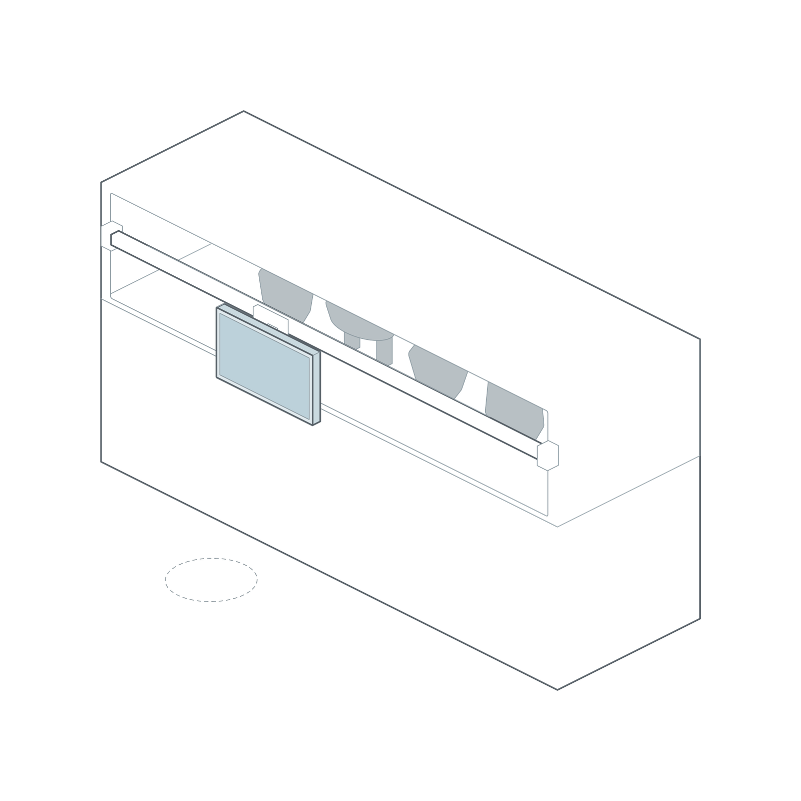
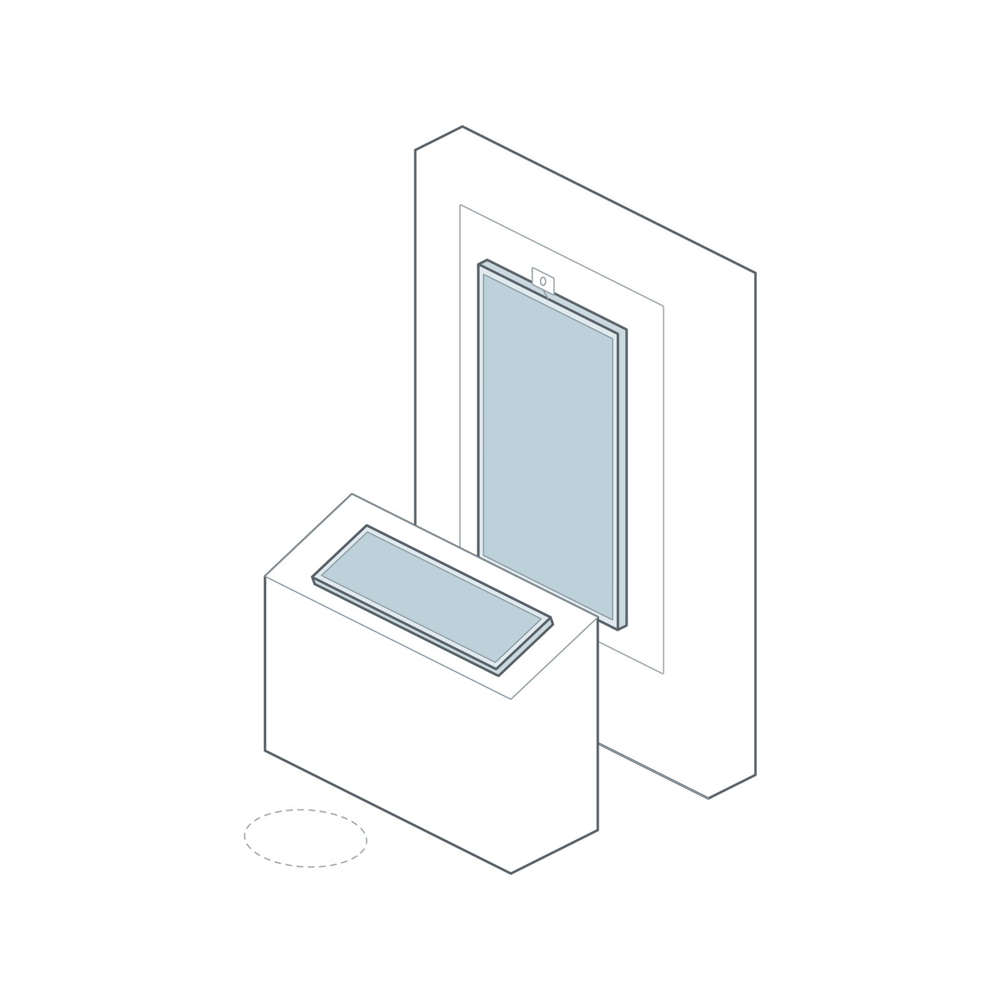
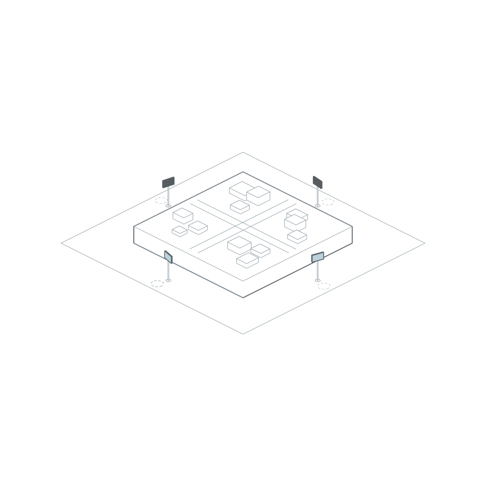
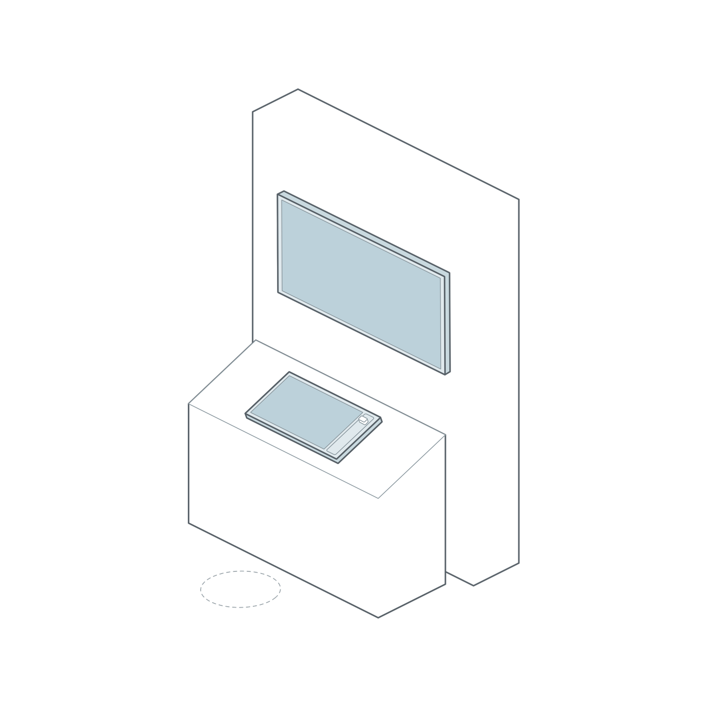
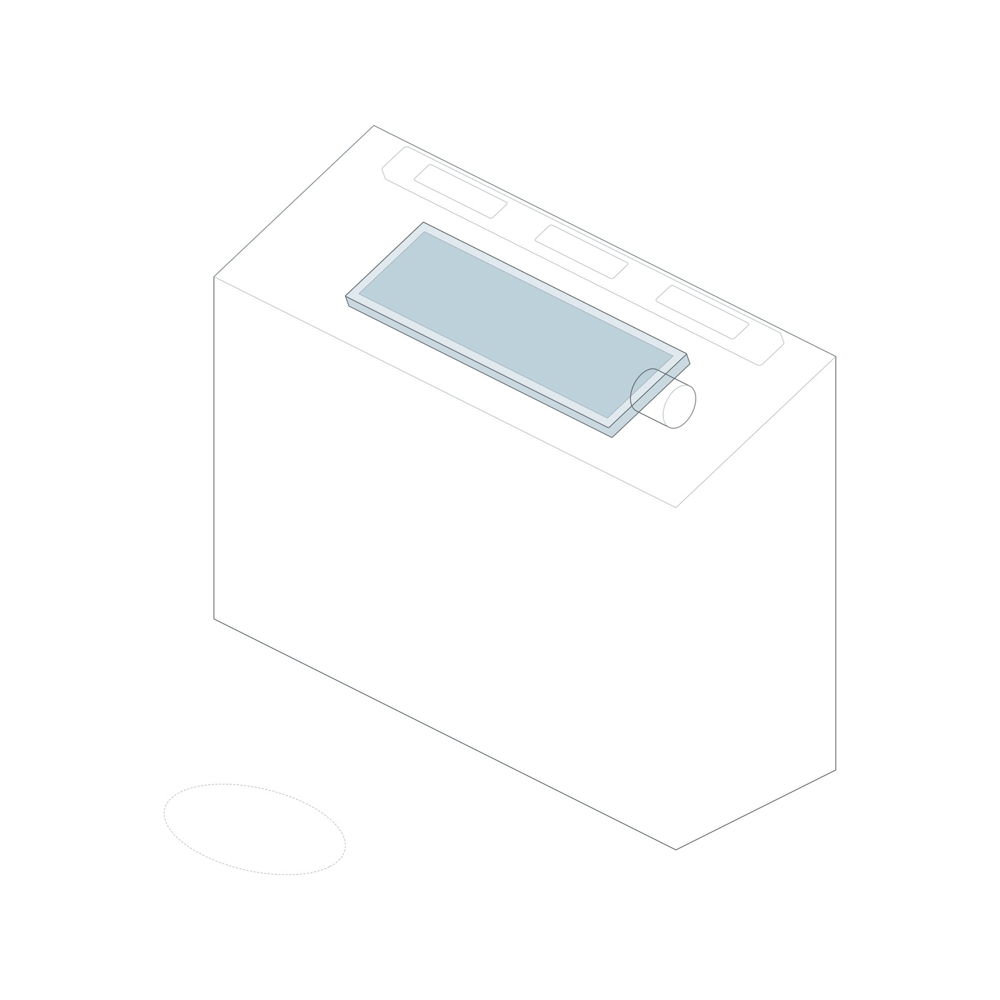
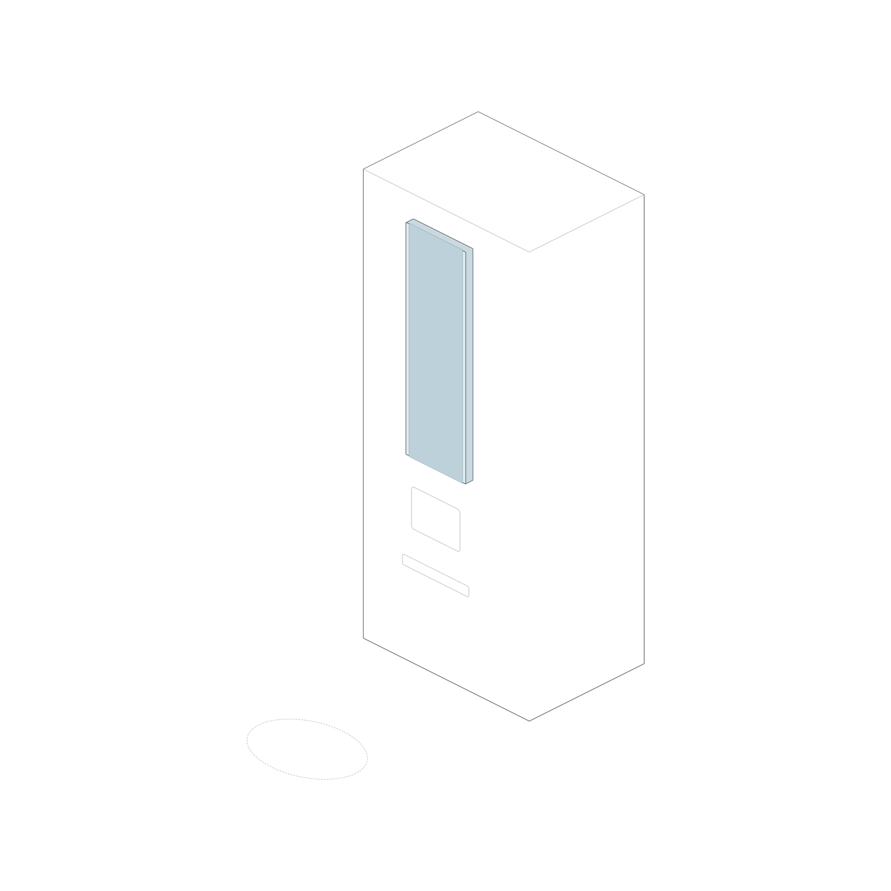

# 文博数字体验解决方案

## 系列化交互终端与场景服务白皮书

V2 场景章节审阅稿  
2026.10

# 目录

| 章节 | 内容 | 页码 |
|---|---|---:|
| 解决方案定义 | 白皮书任务 | 03 |
| 解决方案定义 | 产品族定义 | 04 |
| 解决方案定义 | 解决方案体系 | 05 |
| 推荐场景 | 场景总览 | 06 |
| 推荐场景 | 十个场景方案 | 07—16 |
| 交付范围 | 场景交付清单 | 17—18 |
| 交付范围 | 交付边界 | 19 |

# 白皮书任务

　　文博数字体验解决方案以观众体验为起点，将终端设备、互动结构、界面内容、数据管理与项目服务组织为完整体系。四款标准终端通过模块化设计融入展柜、展墙、独立柜体、互动桌、沙盘与研学空间，并由国产系统、信息安全和运营平台支撑长期运行。

## 提供完整体验

从观众行为、展览内容和空间条件出发，建立可理解、可操作、可持续的数字体验。

## 形成场景方案

将终端、柜体、基础结构与拓展模块作为一个整体设计，直接提供经过整合的推荐方案。

## 支撑长期运营

覆盖需求诊断、方案深化、设计开发、测试验证、部署运营与内容更新。

> **推荐说明图位 P03-01｜解决方案组成**  
> 终端设备、互动结构、界面内容、数据管理、项目服务五部分围绕“观众体验”组织。

# 产品族定义

　　本产品族是面向博物馆与文化展示空间的系列智慧信息交互终端。它不仅是一块可触摸的交互屏，更是连接展品、内容、空间与观众的数字信息终端。

| 核心特征 | 说明 |
|---|---|
| 文博应用覆盖 | 适配展柜释读、主题探索、研学任务、互动工作台与空间导览 |
| 设备模块化 | 四款标准终端可与柜体、滑轨、转轴、抽屉及实体操作件协同 |
| 系统国产化 | 采用国产ARM架构处理器、开源鸿蒙系统与团结引擎技术路线 |
| 信息安全化 | 支持项目级网络隔离、权限控制、版本管理与安全部署 |
| 运营平台化 | 支持内容、设备、版本、状态与维护工作的持续管理 |

## 四款标准终端

21.5寸终端用于近距离精细操作；L29终端用于连续信息和狭长空间；43寸终端用于大画幅触摸和多人观看；L43终端用于横向叙事与连续浏览。

> **推荐说明图位 P04-01｜产品族轮廓**  
> 四款终端按同比例排列，只标注名称、方向与主要角色，不堆叠技术参数。

# 解决方案体系

| 体系层 | 解决的问题 | 主要内容 |
|---|---|---|
| 文博应用空间 | 终端放在哪里、承担什么体验任务 | 展柜、展墙、独立柜体、互动桌、沙盘、研学空间 |
| 模块化终端与结构 | 如何形成可操作的空间节点 | 标准终端、柜体、滑轨、转轴、斜面、抽屉与实体操作件 |
| 国产系统与信息安全 | 如何稳定、安全地运行 | 国产ARM架构、开源鸿蒙、团结引擎、权限与版本控制 |
| 数据运营与全周期服务 | 如何持续更新与维护 | 内容管理、设备状态、数据记录、巡检、升级与服务响应 |

## 服务流程

**需求诊断 → 场景匹配 → 方案深化 → 设计开发 → 测试验证 → 部署运营**

> **推荐说明图位 P05-01｜解决方案体系图**  
> 以文博应用空间为起点，依次连接模块化终端、国产安全底座与运营服务，不展开接口和零部件参数。

# 推荐场景总览

| 编号 | 场景 | 主要体验 | 终端配置 |
|---:|---|---|---|
| 01 | 滑轨展柜透视屏 | 移动屏幕，定位并透视展品 | 21.5寸终端 × 1 |
| 02 | 唐代服饰数字换装站 | 选择服饰并获得实时全身反馈 | 43寸终端 × 1；L29终端 × 1 |
| 03 | 沙盘方位观察终端 | 转动终端，观察对应方位 | 21.5寸终端 × 2—4 |
| 04 | 实体信物触发叙事台 | 放置信物，查证并展开叙事 | 43寸终端 × 1；21.5寸终端 × 1 |
| 05 | 纹饰识别旋钮台 | 旋转浏览并放大纹饰细节 | L29终端 × 1 |
| 06 | NFC研学任务站 | 识别身份并完成研学任务 | L29终端 × 1 |
| 07 | 考古层位剥离台 | 多指剥离数字层位并判断关系 | 43寸终端 × 1 |
| 08 | 档案抽屉检索台 | 打开抽屉并深读对应档案 | 21.5寸终端 × 1 |
| 09 | 文物灯光揭示台 | 调整安全照明并观察细节 | L29终端 × 1 |
| 10 | 手摇时光放映台 | 手摇时间并在屏幕中检索章节 | L29终端 × 1 |

> **推荐说明图位 P06-01｜十个场景索引**  
> 采用2列×5行缩略图矩阵，缩略图只显示场景轮廓、编号和名称。

# 01 滑轨展柜透视屏

将触摸终端变为可移动的数字观察窗，使屏幕位置、展品位置与数字图层保持对应。

## 如何体验

**移动定位**　观众沿展柜推动终端，对准目标展品。  
**触摸观察**　通过点击、滑动和缩放查看现状、X光、结构与修复记录。  
**返回实物**　数字信息保持与展品对应，观众可随时在屏幕与实物之间比较。

| 配置项 | 推荐方案 |
|---|---|
| 终端 | 21.5寸终端 × 1，横向安装 |
| 柜体 | 既有展柜或定制展柜前部结构 |
| 基础结构 | 水平滑轨、限位与维护结构 |
| 拓展模块 | 位置检测模块 |

适合场馆与展项：考古类、文史类、自然科学类场馆；文物展柜、标本观察、修复研究与细节释读展项。

# 02 唐代服饰数字换装站

选择服饰与实时取景处于同一视觉中轴，观众在操作过程中持续看见自己的完整换装结果。

## 如何体验

**进入取景**　观众站在地面取景位置，主屏显示实时全身画面。  
**选择服饰**　在低角度L29终端中上下滑动，选择服饰部件。  
**查看结果**　43寸终端同步呈现换装效果，并支持细节查看与文化说明。

| 配置项 | 推荐方案 |
|---|---|
| 终端 | 竖向43寸终端 × 1；低角度L29终端 × 1 |
| 柜体 | 主屏与操作台一体化柜体 |
| 基础结构 | 同轴主屏、斜面操作台、地面取景位置 |
| 拓展模块 | 摄像头；项目需要时增加补光与环境检测 |

适合场馆与展项：文史类、服饰类、民俗类与专题博物馆；历史服饰、人物形象、礼制文化与角色换装展项。

# 03 沙盘方位观察终端

观众通过转动终端选择观察方位，在实体沙盘和数字信息之间建立直接的空间映射。

## 如何体验

**转动指向**　观众握持终端，将屏幕转向沙盘中的目标区域。  
**触摸探索**　点击、拖动和缩放查看建筑、事件与数据图层。  
**多人并行**　不同位置的观众可同时观察不同方位，互不遮挡。

| 配置项 | 推荐方案 |
|---|---|
| 终端 | 21.5寸终端 × 2—4 |
| 柜体 | 中央沙盘与外圈独立终端节点 |
| 基础结构 | 独立支撑杆、旋转关节、限位结构 |
| 拓展模块 | 角度编码或姿态检测模块 |

适合场馆与展项：考古类、历史地理类、城市规划类与科普类场馆；遗址沙盘、建筑群、城市演变与地理探索展项。

# 04 实体信物触发叙事台

一大一小双屏分别承担查证与叙事，使实体信物、个人操作和共同观看形成连续过程。

## 如何体验

**放置信物**　观众将人物、事件或文物信物放在识别区。  
**查证线索**　在21.5寸终端中翻查档案、确认人物与证据。  
**展开叙事**　43寸终端同步呈现关系、时间线和多人可见的叙事结果。

| 配置项 | 推荐方案 |
|---|---|
| 终端 | 竖向43寸终端 × 1；21.5寸终端 × 1 |
| 柜体 | 后部主屏柜体＋前部斜面操作台 |
| 基础结构 | 识别面、信物放置区与收纳位置 |
| 拓展模块 | NFC或RFID识别模块；实体信物 |

适合场馆与展项：纪念馆、文史类场馆、人物专题馆与红色文化场馆；人物关系、事件线索、档案查证与口述历史展项。

# 05 纹饰识别旋钮台

长条触摸屏、实体纹饰样片与旋钮形成连续浏览带，适合融入展柜边缘和狭长空间。

## 如何体验

**对照样片**　观众观察终端后方的纹饰样片或复制件。  
**连续浏览**　横向滑动屏幕或转动旋钮切换纹饰。  
**查看细节**　点击器物卡并缩放纹样，了解年代、工艺与文化含义。

| 配置项 | 推荐方案 |
|---|---|
| 终端 | L29终端 × 1，横向安装 |
| 柜体 | 展柜前缘或独立窄柜体 |
| 基础结构 | 终端、样片带与旋钮沿同一长轴布置 |
| 拓展模块 | 实体旋钮与旋转编码模块 |

适合场馆与展项：考古类、文史类、工艺美术类与非遗类场馆；器物纹饰、工艺分类、图案演变与样片对照展项。

# 06 NFC研学任务站

身份识别、任务操作和进度记录集中在一个可复制的研学节点中。

## 如何体验

**识别身份**　观众将研学卡靠近识别面，调取个人任务。  
**完成任务**　在竖向L29终端中阅读提示、拖拽答案并上传发现。  
**记录进度**　系统保存完成状态，并在后续节点继续研学路径。

| 配置项 | 推荐方案 |
|---|---|
| 终端 | 竖向L29终端 × 1 |
| 柜体 | 独立研学柜体或研学空间侧墙柜 |
| 基础结构 | 上部终端、中部识别面、下部卡片收纳 |
| 拓展模块 | NFC识别模块；研学卡 |

适合场馆与展项：综合博物馆、科技馆、研学教育中心与儿童博物馆；研学任务、知识闯关、参观路线与青少年学习展项。

# 07 考古层位剥离台

以大画幅多点触摸模拟考古记录平面，让层位判断成为可观察、可讨论的操作过程。

> **图片位 P13-01｜考古层位剥离台**  
> 正方形等距轴测图。主体为低角度考古方格台，43寸终端嵌入台面；不绘制工具、刻度和储物细节。S37已有中间输出但未完成QA，暂不用于正式版。

## 如何体验

**观察层位**　观众查看数字探方中的不同土层与遗迹线索。  
**多指剥离**　通过拖动、擦除和缩放逐层揭示遗物。  
**作出判断**　标记位置并判断层位关系，系统反馈推理结果。

| 配置项 | 推荐方案 |
|---|---|
| 终端 | 43寸终端 × 1，水平或约20°低角度安装 |
| 柜体 | 考古方格主题互动台 |
| 基础结构 | 大画幅斜面、四周浅层方格边界 |
| 拓展模块 | 标准方案以多点触摸为主；实体工具按项目深化 |

适合场馆与展项：考古类、遗址类、文史类与科普类场馆；考古发掘、地层关系、遗址研究与考古方法展项。

# 08 档案抽屉检索台

实体抽屉提供主题发现感，触摸终端承担索引、手稿放大与时间线阅读。

> **图片位 P14-01｜档案抽屉检索台**  
> 正方形等距轴测图。21.5寸终端嵌入档案柜斜面，屏幕下方设置两个宽抽屉，其中一个轻微拉出；不绘制滑轨、把手和内部文件细节。

## 如何体验

**打开主题**　观众拉开人物、地点或事件抽屉。  
**检索档案**　在相邻屏幕中点击索引、缩放手稿并拖动时间线。  
**建立关联**　系统呈现抽屉主题与其他馆藏档案的关系。

| 配置项 | 推荐方案 |
|---|---|
| 终端 | 21.5寸终端 × 1，斜面安装 |
| 柜体 | 档案柜主题独立柜体 |
| 基础结构 | 斜面终端＋2—4个主题抽屉 |
| 拓展模块 | 抽屉开启状态检测 |

适合场馆与展项：纪念馆、档案馆、文史类场馆与人物专题馆；历史档案、人物手稿、事件时间线与馆藏检索展项。

# 09 文物灯光揭示台

观众在安全照明预设范围内调整观察条件，发现材质、纹理与制作痕迹。

> **图片位 P15-01｜文物灯光揭示台**  
> 正方形等距轴测图。L29终端嵌入展柜前缘，柜内只保留展品体块与一组受控灯具轮廓，强调屏幕、灯光和展品的对应关系。

## 如何体验

**选择任务**　观众在L29终端中选择需要观察的细节。  
**调整照明**　在安全预设内滑动切换照明方向或亮度。  
**对照理解**　观察实物变化，并在屏幕中放大对应细节和工艺说明。

| 配置项 | 推荐方案 |
|---|---|
| 终端 | L29终端 × 1，横向安装 |
| 柜体 | 文物展柜前缘信息带 |
| 基础结构 | 屏幕与展品观察面对应布置 |
| 拓展模块 | 受控灯具、照明控制与安全预设模块 |

适合场馆与展项：文史类、艺术类、工艺美术类与自然科学类场馆；材质观察、制作痕迹、文物修复与标本细节展项。

# 10 手摇时光放映台

实体手摇控制时间方向，触摸终端负责章节选择、时间定位与内容深读。

> **图片位 P16-01｜手摇时光放映台**  
> 正方形等距轴测图。L29终端与单个手摇柄并列嵌入放映机造型柜体；不绘制齿轮、传动轴和内部连接件。

## 如何体验

**手摇时间**　观众转动手柄，使影像前进、后退或改变速度。  
**触摸定位**　在L29终端中点击章节并拖动时间轴。  
**查看细节**　暂停画面并缩放人物、建筑或历史事件信息。

| 配置项 | 推荐方案 |
|---|---|
| 终端 | L29终端 × 1，横向安装 |
| 柜体 | 放映机主题独立柜体 |
| 基础结构 | 屏幕与手摇柄并列的操作面 |
| 拓展模块 | 手摇柄、旋转编码模块 |

适合场馆与展项：文史类场馆、纪念馆、电影博物馆与工业科普类场馆；历史影像、时代进程、机械原理与档案放映展项。

# 场景交付清单（一）

| 场景 | 硬件与结构 | 软件与内容 | 数据与服务 |
|---|---|---|---|
| 滑轨展柜透视屏 | 21.5寸终端、滑轨、位置检测、展柜适配 | 展品定位、图层对照、细节缩放 | 内容关联、位置标定、安装调试、培训维护 |
| 唐代服饰数字换装站 | 43寸终端、L29终端、柜体、摄像头 | 服饰选择、实时取景、换装合成、文化说明 | 素材管理、效果标定、现场调试、隐私策略 |
| 沙盘方位观察终端 | 2—4台21.5寸终端、旋转支架、姿态检测 | 方位映射、建筑与事件探索、数据图层 | 坐标标定、多终端配置、安装验收、维护 |
| 实体信物触发叙事台 | 43寸终端、21.5寸终端、识别面、实体信物 | 信物识别、档案查证、关系与时间线叙事 | 信物映射、内容配置、设备联调、培训维护 |
| 纹饰识别旋钮台 | L29终端、窄柜体、样片带、旋钮 | 连续浏览、器物卡、纹饰缩放与说明 | 旋钮标定、内容管理、安装调试、维护 |

# 场景交付清单（二）

| 场景 | 硬件与结构 | 软件与内容 | 数据与服务 |
|---|---|---|---|
| NFC研学任务站 | L29终端、研学柜体、NFC模块、研学卡 | 身份识别、任务、答题、发现上传、进度反馈 | 身份与任务记录、节点配置、培训维护 |
| 考古层位剥离台 | 43寸终端、低角度方格台 | 多指剥离、缩放、标记、层位判断 | 内容分层、难度配置、安装验收、维护 |
| 档案抽屉检索台 | 21.5寸终端、档案柜、抽屉状态检测 | 主题索引、手稿缩放、时间线与关系阅读 | 抽屉映射、档案管理、调试、培训维护 |
| 文物灯光揭示台 | L29终端、展柜适配、受控灯具 | 观察任务、安全照明预设、细节对照 | 照度策略、状态记录、联调、巡检维护 |
| 手摇时光放映台 | L29终端、主题柜体、手摇与编码模块 | 播放控制、章节、时间轴、画面缩放 | 速度映射、内容管理、调试、培训维护 |

# 交付边界

## 标准交付

- 标准终端硬件、基础系统与已确认接口能力。
- 视频、文字、多图、查询、三维模型查看、常亮展示与视觉导视等基础应用能力。
- 设备安装、基础调试、操作说明与常规验收资料。

## 场景方案交付

- 推荐场景的终端配置、柜体关系、基础结构与指定拓展模块。
- 场景交互流程、UI设计、数字内容组织与数据管理方案。
- 软硬件联调、现场部署、培训、验收与维护建议。

## 项目深化

- 根据建筑条件、展柜、文物安全、内容规模和运营目标进行尺寸、结构与交互深化。
- 非标准柜体、特殊机械结构、传感器、灯光、摄像头及系统定制开发。
- 专题内容制作、数据接口、平台对接、长期运营与升级服务。

## 独立商务文件

产品价格不进入本白皮书，由独立报价表管理。交付周期与质保期限在正式发布前完成商务确认，并在后续服务章节中列明。
